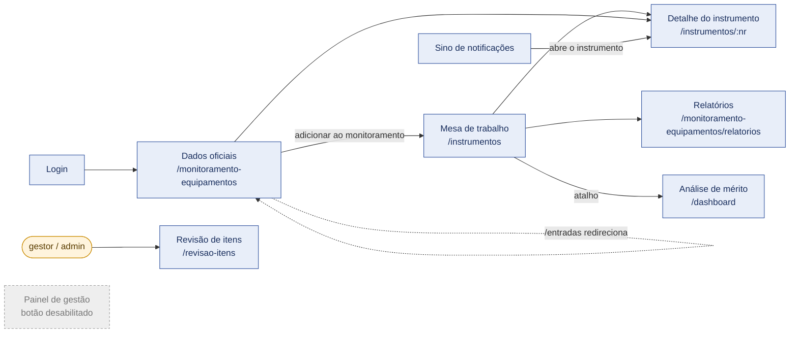
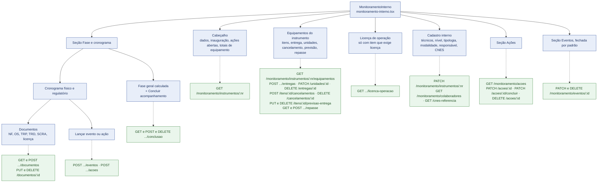
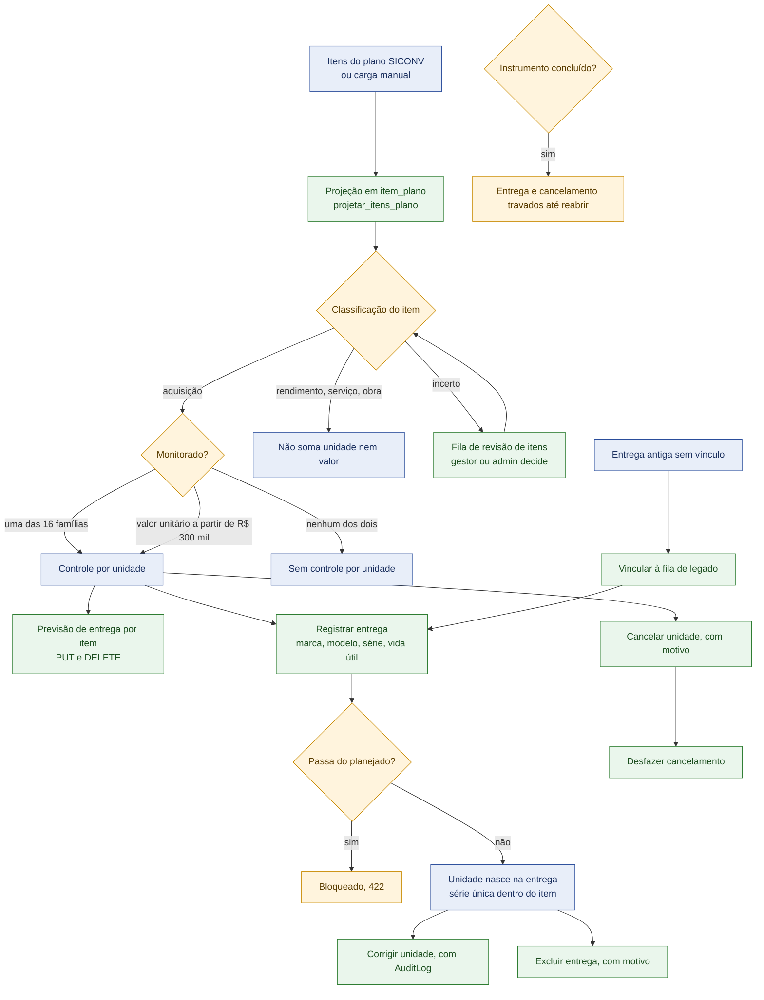
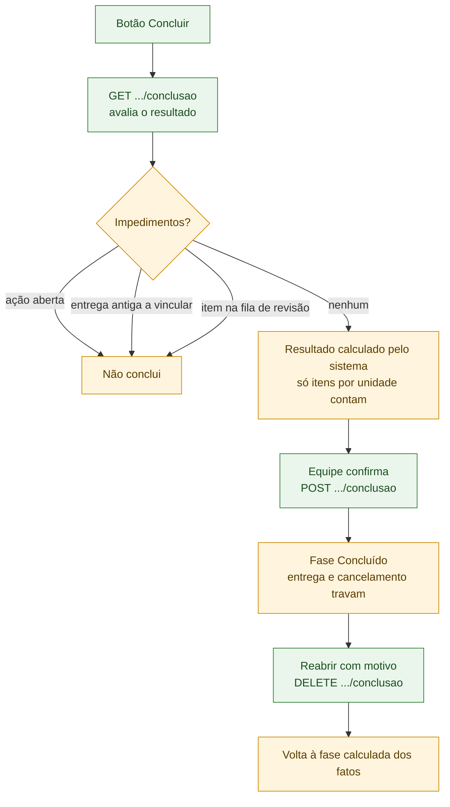
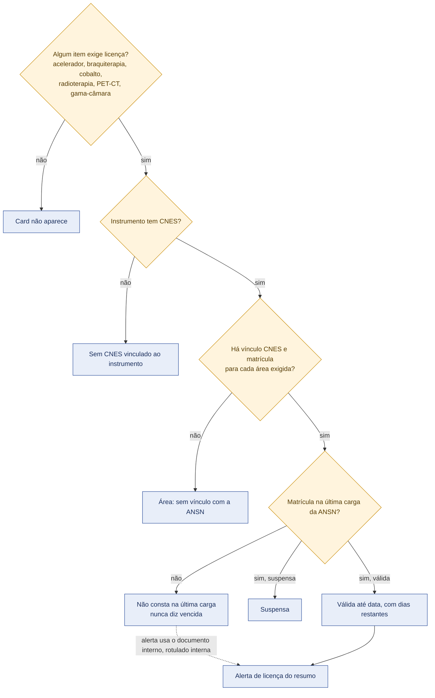
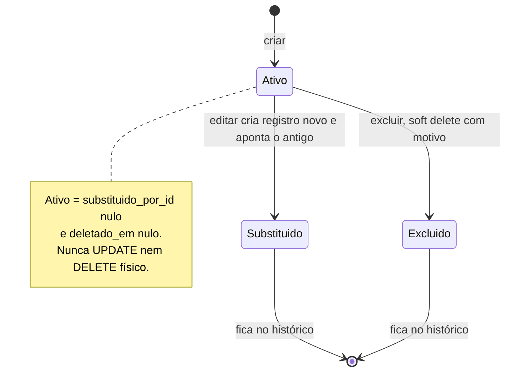
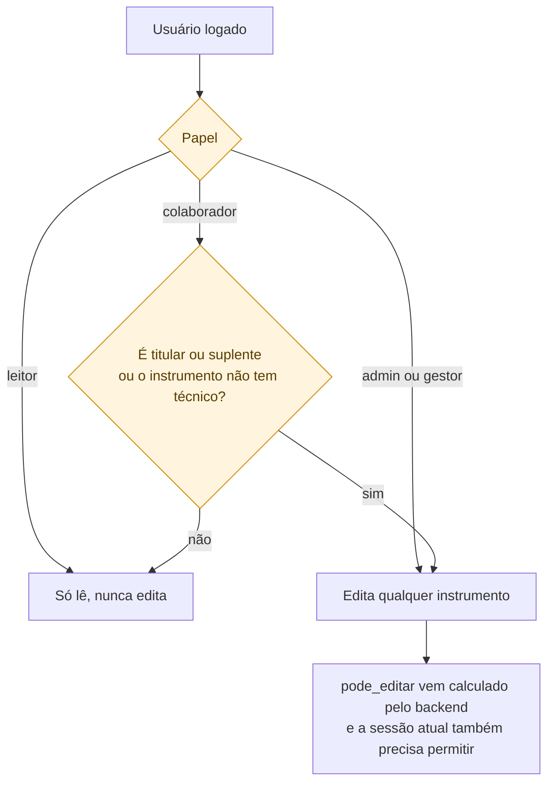
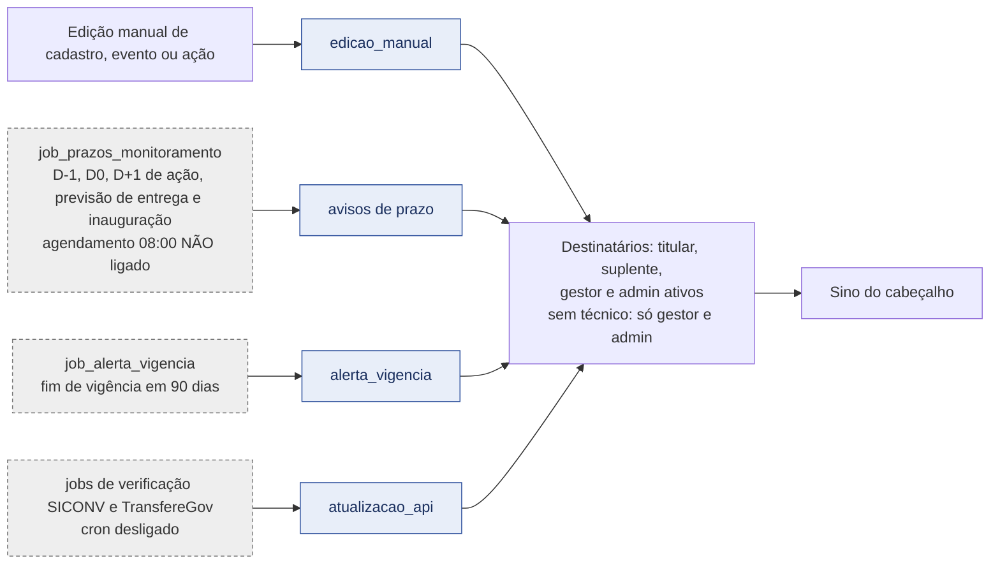

# Mapa do Monitoramento interno (19/11/2026)

Objetivo: servir de base para a equipe validar o fluxo e apontar funcionalidade ou código sem uso. Tudo aqui foi lido do código da branch `feat/persus-ii-fora-do-monitoramento` (estado de 19/11/2026). Os diagramas usam Mermaid e renderizam no Obsidian, no GitHub e no VS Code.

Escopo: Mesa de trabalho (`/monitoramento-equipamentos/instrumentos`), detalhe do instrumento (`/monitoramento-equipamentos/instrumentos/:nr`) e a fila de revisão de itens. O Painel de Gestão está desabilitado (flag `PAINEL_GESTAO_HABILITADO`) e fica fora deste mapa.

## 1. Telas e navegação

## 2. Estrutura da página de detalhe

Cada bloco é um componente em `frontend/src/components/features/`. A coluna da direita mostra de onde vêm os dados.

## 3. Fase do acompanhamento (calculada, nunca escolhida)

A fase sai de fatos acumulados (`services/fase_acompanhamento.py`). O fato mais avançado decide. Atualização externa não faz a fase regredir.

```mermaid
stateDiagram-v2
    direction LR
    [*] --> AcompanhamentoIniciado
    AcompanhamentoIniciado --> AguardandoRepasse: repasse previsto
    AguardandoRepasse --> ValorRepassado: repasse confirmado
    AcompanhamentoIniciado --> ValorRepassado: repasse confirmado
    ValorRepassado --> EmAquisicao: licitação ou contrato ou fabricação realizada
    EmAquisicao --> EquipamentoEntregue: entrega lançada
    ValorRepassado --> EquipamentoEntregue: entrega sem repasse também avança
    AcompanhamentoIniciado --> EquipamentoEntregue: idem
    EquipamentoEntregue --> PosEntrega: instalação, comissionamento, treinamento ou operação
    PosEntrega --> Concluido: conclusão confirmada pela equipe
    EquipamentoEntregue --> Concluido: conclusão confirmada
    Concluido --> EquipamentoEntregue: reabertura com motivo
```

Nomes na tela: Acompanhamento iniciado, Aguardando repasse, Valor repassado, Em aquisição, Equipamento entregue, Pós-entrega, Concluído.

### Marcos do cronograma liberados por fase (`marcos_por_fase.py`)

| Grupo de marcos | Liberado a partir de | Até |
|---|---|---|
| Fabricação, chegada ao Brasil, desembaraço | Valor repassado | Em aquisição |
| Obra e reforma | Acompanhamento iniciado | Equipamento entregue |
| Instalação, comissionamento, treinamento, início da operação | Equipamento entregue | Pós-entrega |
| Em Concluído | nada se lança (reabrir antes) | |

Fora da janela a opção aparece desabilitada com o motivo, e o backend recusa com 422. Vale só para lançamento novo, não para correção.

## 4. Itens, entregas e unidades

## 5. Concluir e reabrir o acompanhamento

## 6. Licença de operação (por estabelecimento CNES)

A carga da ANSN e dos vínculos é feita pela equipe direto no banco (`scripts/importar_licencas_ansn.py`). Ainda não há tela para vincular ou trocar matrícula.

## 7. Registros append-only (eventos, ações, documentos)

Tipos de documento: nota fiscal, ordem de serviço, TRP, TRD, CNEN SCRA e CNEN licença. Status CNEN: Em análise, Em diligência, Deferido, Indeferido. Validade só vale na licença.

Inauguração: previsão, realizada e "dispensada" são excludentes, no máximo um evento ativo no conjunto (409 se repetir). Entrega por item não passa mais pelo seletor de marcos da linha do tempo.

## 8. Quem pode editar

Fila de revisão de itens: só gestor e admin (`GestaoRoute`).

## 9. Avisos e jobs

## 10. Registro de funcionalidades (para a equipe marcar)

Marque a coluna final com **usa**, **não usa** ou **não conheço**.

| # | Funcionalidade | Onde fica | Equipe usa? |
|---|---|---|---|
| 1 | Filtros da Mesa: busca por número, convenente, CNES ou município; contratação; CNES; UF; município; prioritário; equipamento; situação; programa; período | Mesa de trabalho | |
| 2 | Indicadores no topo da Mesa e lista de instrumentos | Mesa de trabalho | |
| 3 | Adicionar instrumento ao monitoramento | Dados oficiais | |
| 4 | Cadastro interno (técnico titular e suplente, nível, tipologia, modalidade, responsável da execução, CNES) | Detalhe | |
| 5 | Editar só o CNES | Detalhe, cabeçalho | |
| 6 | Registrar entrega com várias unidades por item | Detalhe, Equipamentos | |
| 7 | Corrigir unidade (marca, modelo, série, vida útil) | Detalhe, Equipamentos | |
| 8 | Excluir entrega com motivo | Detalhe, Equipamentos | |
| 9 | Cancelar e desfazer cancelamento de unidade | Detalhe, Equipamentos | |
| 10 | Previsão de entrega por item (definir e remover) | Detalhe, Equipamentos | |
| 11 | Confirmar repasse integral ou parcial | Detalhe, Equipamentos | |
| 12 | Vincular entrega antiga (legado) | Detalhe, Equipamentos | |
| 13 | Card de licença de operação (somente leitura) | Detalhe | |
| 14 | Documentos (6 tipos), incluindo corrigir e excluir | Detalhe, Cronograma | |
| 15 | Lançar evento de cronograma e regulatório | Detalhe, Cronograma | |
| 16 | Editar e excluir evento, com motivo | Detalhe, Eventos | |
| 17 | Ações: criar, editar, concluir, excluir, com prazo e responsável | Detalhe, Ações | |
| 18 | Concluir e reabrir acompanhamento | Detalhe, Fase | |
| 19 | Fila de revisão de itens (confirmar, corrigir, não é equipamento) | Revisão de itens | |
| 20 | Notificações por edição, prazo e vigência | Sino | |
| 21 | Relatórios de instrumentos e repasse (Excel e Word) | Relatórios | |

## 11. Candidatos a código sem uso (verificados por busca no código)

Método: busca por nome em todo o `frontend/src` e `backend` (incluindo testes). **Candidato não é prova**: confirme com a equipe antes de apagar. Nada foi removido.

### Backend

| Item | Evidência | Observação |
|---|---|---|
| `repositories/documentos.py::codigos_familias_com_licenca` | Nenhuma chamada em `app`, `tests` ou `scripts` | Sobrou da licença por item, que foi removida. Apagar |
| `repositories/monitoramento.py::listar_marcos_fase_geral_desc` | Nenhuma chamada | Provável resto do tempo em que a fase geral era escolhida; hoje ela é calculada |
| `repositories/monitoramento.py::preencher_ano_convenio_se_ausente` | Nenhuma chamada | Provável resto de carga antiga; ver `scripts/preencher_ano_*.py` |
| `repositories/auditoria_marcadores.py` | Importado só por 1 teste | Confirmar se algum script ou tela usa |

### Frontend

| Item | Evidência | Observação |
|---|---|---|
| `AjudaCampo` (`monitoramento-ui.tsx`) | 0 usos em qualquer arquivo | Apagar |
| `useEntregasLegadas` (`useEquipamentosInstrumento.ts`) | 0 usos | Confirmar se a fila de legado tem outra entrada na tela |
| `TECNICOS_EQUIPE` (`lib/monitoramento-opcoes.ts`) | 0 usos | Lista fixa; o cadastro hoje usa `GET /monitoramento/colaboradores` (a confirmar) |
| `LEGENDA_STATUS` (`lib/monitoramento-status.ts`) | 0 usos | |
| `getMapThemeColors` (`lib/theme-colors.ts`) | 0 usos | |
| `equipamentosDaProposta` (`lib/proposta-metas-resumo.ts`) | 0 usos | |
| `mediaReferenciaFase`, `formatarNup`, `codificarSituacao` | Usados só em testes e no próprio arquivo | Exportados sem consumidor de tela |
| `motivoExclusaoSchema`, `unidadeEntregaSchema`, `itemEntregaSchema`, `conclusaoKeys`, `documentosKeys` | Usados só dentro do próprio arquivo | Só o `export` está sobrando |
| `/monitoramento-equipamentos/entradas` | Rota que só redireciona | Mantida por links antigos; confirmar se pode sair |
| Tipos órfãos em `types/monitoramento.ts` (`ProgramaTransfereGov`, `ConvenioPortal`, `EtapaExpandida`, `PropostaExpandida`, `ComponentePropostaApi`, `ComponenteOncologia`) | Sem importador | Heranças do desenho antigo de propostas |

Todas as rotas de `routers/monitoramento.py`, `entregas.py`, `documentos.py`, `conclusao.py`, `repasses.py` e `licenca_operacao.py` têm consumidor no frontend (busca pelo caminho).

### Scripts de uma só execução (arquivar depois do release)

`migrar_marcos_para_documentos`, `migrar_concluidos_para_conclusao`, `migrar_eventos_inauguracao_prevista`, `remover_persus_ii_do_monitoramento`, `corrigir_entregas_persus_i`, `consolidar_eventos_marco_duplicados`, `vincular_entregas_legadas`, `derivar_repasses_siconv`, `projetar_itens_plano` (este também serve de rotina recorrente), `preencher_*`, `importar_planilha_monitoramento`, `importar_programas_monitoramento`. Depois do release e da conferência em produção, mover para `scripts/arquivo/` ou remover, mantendo o histórico no git.

Pendente já registrado no plano do fluxo: remover a leitura do evento antigo `fase_concluido` em `fatos_do_instrumento` e `fases_calculadas_em_lote` depois de conferir a produção.

## 12. Limites desta análise

- Busca textual, não análise de grafo de chamadas: função chamada por nome dinâmico ou por reflexão não seria detectada.
- Endpoints foram cruzados com o frontend pelo caminho; endpoint usado só por script externo apareceria como "com consumidor" se o texto coincidir.
- Uso real em produção não foi medido. Para isso, olhar `AuditLog` por tipo de ação (quem lançou o quê, quando) é o melhor indicador de funcionalidade que a equipe não usa.
