# Mapa do Monitoramento interno (19/11/2026, revisão 2)

Objetivo: servir de base para a equipe validar o fluxo e apontar funcionalidade ou código sem uso. Tudo aqui foi lido do código da branch `feat/persus-ii-fora-do-monitoramento` (estado de 19/11/2026, depois da revisão 2). Os diagramas usam Mermaid e renderizam no Obsidian, no GitHub e no VS Code.

Escopo: Mesa de trabalho (`/monitoramento-equipamentos/instrumentos`), detalhe do instrumento (`/monitoramento-equipamentos/instrumentos/:nr`), Radar de instrumentos e fila de revisão de itens. O Painel de Gestão está desabilitado (flag `PAINEL_GESTAO_HABILITADO`) e fica fora deste mapa.

Mudanças da revisão 2: instrumento concluído trava todas as edições; as 16 famílias entram no diagrama de itens; exceções de itens, entregas e unidades listadas; Radar só para gestor e admin, com card enxuto e aprovação com técnico; jobs detalhados; código sem uso removido.

## 1. Telas e navegação

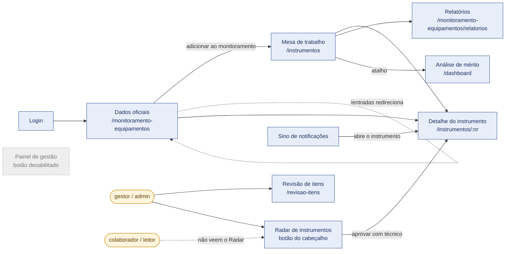

## 2. Estrutura da página de detalhe

Cada bloco é um componente em `frontend/src/components/features/`. A linha tracejada mostra de onde vêm os dados. Com o acompanhamento **concluído**, todos os blocos ficam somente leitura, exceto "Concluir / Reabrir" (ver seção 5).

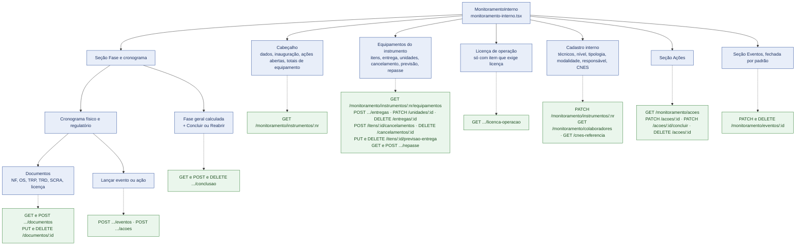

## 3. Fase do acompanhamento (calculada, nunca escolhida)

A fase sai de fatos acumulados (`services/fase_acompanhamento.py`). O fato mais avançado decide. Atualização externa não faz a fase regredir.

```mermaid
stateDiagram-v2
    direction LR
    [*] --> AcompanhamentoIniciado
    AcompanhamentoIniciado --> AguardandoRepasse: repasse previsto
    AguardandoRepasse --> ValorRepassado: repasse confirmado
    AcompanhamentoIniciado --> ValorRepassado: repasse confirmado
    ValorRepassado --> EmAquisicao: licitação ou contrato ou fabricação realizada
    EmAquisicao --> EquipamentoEntregue: entrega lançada
    ValorRepassado --> EquipamentoEntregue: entrega sem repasse também avança
    AcompanhamentoIniciado --> EquipamentoEntregue: idem
    EquipamentoEntregue --> PosEntrega: instalação, comissionamento, treinamento ou operação
    PosEntrega --> Concluido: conclusão confirmada pela equipe
    EquipamentoEntregue --> Concluido: conclusão confirmada
    Concluido --> EquipamentoEntregue: reabertura com motivo
```

Nomes na tela: Acompanhamento iniciado, Aguardando repasse, Valor repassado, Em aquisição, Equipamento entregue, Pós-entrega, Concluído.

### Marcos do cronograma liberados por fase (`marcos_por_fase.py`)

| Grupo de marcos | Liberado a partir de | Até |
|---|---|---|
| Fabricação, chegada ao Brasil, desembaraço | Valor repassado | Em aquisição |
| Obra e reforma | Acompanhamento iniciado | Equipamento entregue |
| Instalação, comissionamento, treinamento, início da operação | Equipamento entregue | Pós-entrega |
| Em Concluído | nada se lança (reabrir antes) | |

Fora da janela a opção aparece desabilitada com o motivo, e o backend recusa com 422. Vale só para lançamento novo, não para correção.

## 4. Itens, entregas e unidades

### 4.1 As 16 famílias com controle por unidade

Item de uma destas famílias sempre é monitorado por unidade e define "Prioritário". Quatro delas exigem licença de operação (ANSN); Cobalto e Radioterapia também exigem, mas não têm controle por unidade.

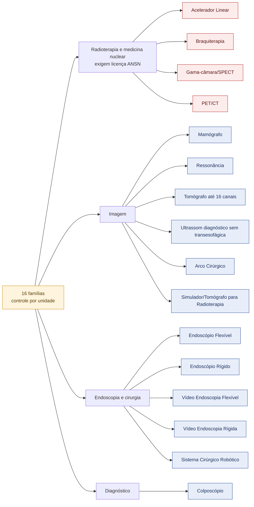

Os agrupamentos (radioterapia, imagem, endoscopia) são só para leitura do diagrama; o sistema trata as 16 igualmente.

### 4.2 Fluxo do item

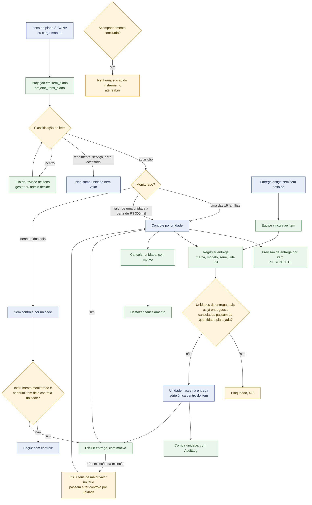

### 4.3 Exceções e travas (lidas do código)

| Situação | O que acontece | Onde |
|---|---|---|
| Entrega passa do planejado | Compara **quantidade**, não data: unidades novas maiores que `planejado − já entregue − canceladas` dão 422 | `entregas_equipamento._validar_itens` |
| Data da entrega no futuro | 422 | `registrar_entrega` |
| Instrumento monitorado sem nenhum item controlado | Entrou pelo componente: o item de aquisição classificado cuja unidade vale **R$ 100 mil ou mais** passa a ter controle por unidade, para a entrega poder ser lançada (`limite_valor_unitario_excecao`) | `projetar_itens_plano._aplicar_excecao_instrumento` |
| Nenhum item chega a R$ 100 mil (exceção da exceção) | Os **3 itens de maior valor unitário** do instrumento viram controle por unidade (`itens_excecao_da_excecao`) | `projetar_itens_plano._aplicar_excecao_instrumento` |
| Equipamento fora das 16 famílias | Monitorado por item só se a unidade vale **R$ 300 mil ou mais** (`limite_valor_unitario_monitorado`); valor da unidade = valor do item no plano ÷ quantidade | `classificacao_itens`, `projetar_itens_plano` |
| Item sem quantidade planejada | Exige confirmar a quantidade entregue; não permite cancelar unidade | `_validar_itens`, `cancelamento_unidade` |
| Item não controlado por unidade | Entrega recusada (item fora das 16 famílias e abaixo de R$ 300 mil) | `_validar_itens` |
| Item de outro instrumento ou inativo | Tratado como inexistente, sem vazar que existe | `_validar_itens` |
| Mesmo item duas vezes na entrega | 422 | `_validar_itens` |
| Entrega sem item vinculado | 422: toda entrega liga ao menos um item | `_validar_itens` |
| Número de série repetido | 422 na mesma entrega, 409 se já existe no item | `_limpar_series`, `_validar_itens` |
| Reenvio da mesma entrega | Idempotente pela `chave_idempotencia`; chave de outro instrumento dá 409 | `registrar_entrega` |
| Unidade com entrega excluída | Não pode ser corrigida | `corrigir_unidade` |
| Excluir entrega | Exige motivo; entrega já excluída dá 422 | `excluir_entrega` |
| Cancelamento | Exige unidade pendente; já desfeito dá 409 | `cancelamento_unidade` |
| Rendimento de aplicação | Não soma unidade nem valor; aparece como linha filha do item principal | `classificacao_itens` |
| Carga manual | Não tem valor, então não entra na regra de R$ 300 mil | `classificacao_itens` |
| Decisão da equipe na fila de revisão | Prevalece sobre a regra automática | `decisao_classificacao_item` |
| Convênio com todos os itens obra ou serviço | `fora_escopo_equipamentos=true`: some de tudo | `instrumento_no_escopo()` |
| PERSUS II | Fora do monitoramento interno | `criar_instrumento_monitorado` |
| Acompanhamento concluído | Nada pode ser alterado até reabrir (seção 5) | `assert_nao_concluido` |

### 4.4 Entrega antiga sem item definido

**O que é.** Antes do controle por unidade, a entrega era um evento do cronograma (marco `cronograma_entrega`), sem dizer qual item foi entregue. Ao migrar, o script `vincular_entregas_legadas` liga a entrega ao item só quando há exatamente um item controlado e ativo no instrumento. Nos demais casos ele **não escolhe**: grava um pedido de revisão (`entrega_legada_revisao`) com o motivo (`varias_entregas`, `sem_item_controlado`, `varios_itens`, `quantidade_desconhecida`).

**Finalidade.** Não perder o histórico, não adivinhar a qual equipamento a entrega pertence e não contar a mesma entrega duas vezes. Enquanto o pedido está pendente, o item aparece como "A vincular" e a conclusão do acompanhamento fica impedida. A equipe resolve pelo botão de vincular no próprio item; não existe tela separada de fila.

## 5. Concluir e reabrir o acompanhamento

"Concluído" e "Concluir acompanhamento" são a mesma coisa: a fase Concluído existe quando há conclusão confirmada. Enquanto a migração dos concluídos antigos (`migrar_concluidos_para_conclusao`) não roda em produção, o evento antigo `fase_concluido` também vale como concluído, com a mesma trava, e Reabrir também o desfaz.

Regra: com o acompanhamento **concluído**, o instrumento inteiro fica travado para edição. A única ação liberada é **reabrir** (com motivo). Isso vale para cadastro, entregas, unidades, cancelamentos, previsões, repasse, eventos, ações e documentos.

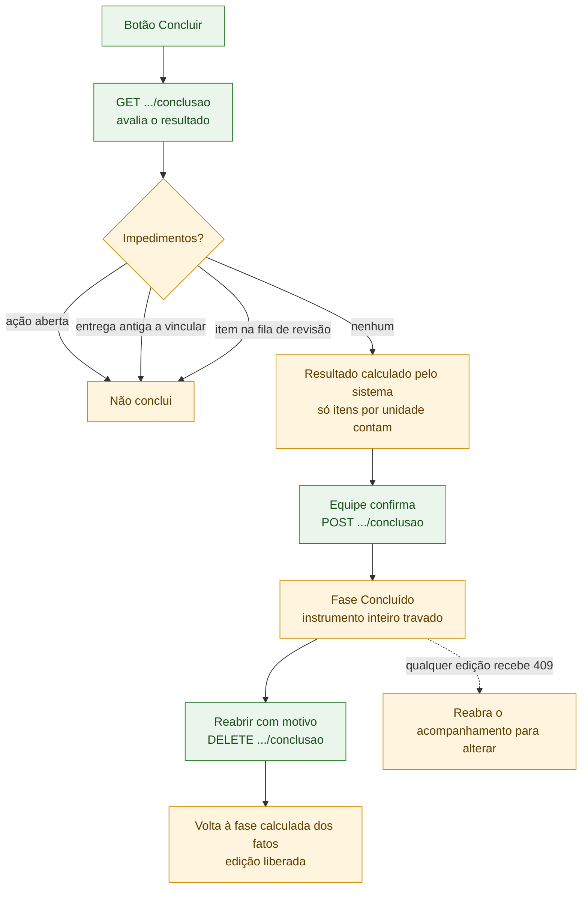

## 6. Licença de operação (por estabelecimento CNES)

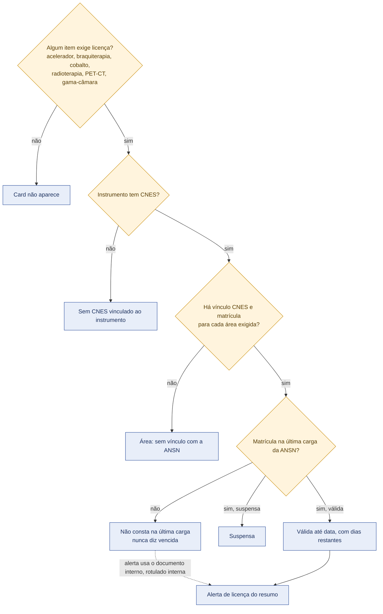

A carga da ANSN e dos vínculos é feita pela equipe direto no banco (`scripts/importar_licencas_ansn.py`). Ainda não há tela para vincular ou trocar matrícula.

## 7. Registros append-only (eventos, ações, documentos)

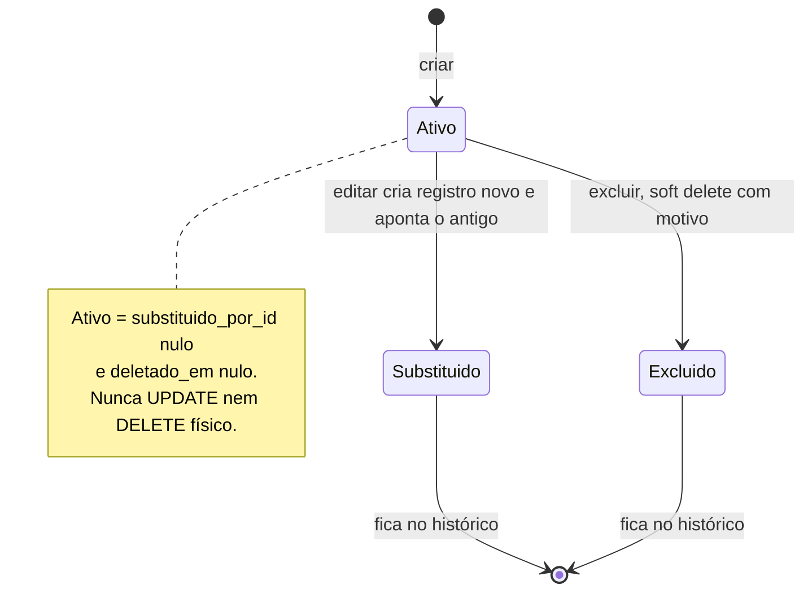

Tipos de documento: nota fiscal, ordem de serviço, TRP, TRD, CNEN SCRA e CNEN licença. Validade só vale na licença.

Inauguração: previsão, realizada e "dispensada" são excludentes, no máximo um evento ativo no conjunto (409 se repetir). Entrega por item não passa mais pelo seletor de marcos da linha do tempo.

## 8. Quem pode fazer o quê

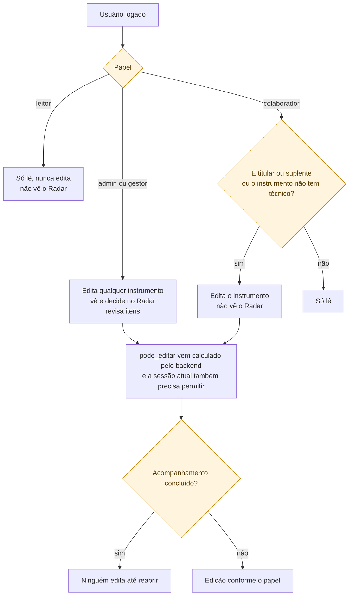

Radar de instrumentos, fila de revisão de itens e aprovação: só gestor e admin. O backend recusa leitura do Radar (lista, histórico, prova) com 403 para os demais papéis, e o botão some do cabeçalho.

## 9. Radar de instrumentos (revisão 2)

O Radar lista convênios novos do SICONV que ainda não estão na carteira. Só gestor e admin acessam.

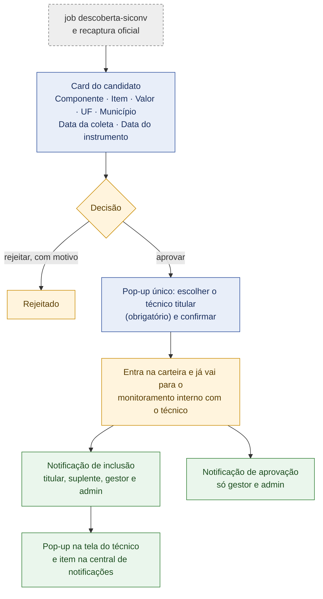

Detalhes do aprovar com técnico:

- O botão **Aprovar** abre o mesmo pop-up de "Adicionar ao monitoramento interno": o técnico titular é obrigatório e **Confirmar** já leva o instrumento ao monitoramento. Não há mais "Iniciar análise"; sobra Aprovar e Rejeitar.
- A lista tem duas abas: **Aguardando** (novo e em análise) e **Arquivados** (aprovado e rejeitado). O card não mostra o campo Item; o botão **Ver itens** abre um pop-up com todos os bens da última recaptura.
- Com técnico, a mesma transação cria o instrumento monitorado (tipo Convênio, origem `radar_aprovacao`), grava o titular e emite o aviso de inclusão. Se qualquer passo falhar, nada é gravado.
- O pop-up aparece na tela do técnico indicado, no próximo ciclo do sino (até 60 segundos), uma vez por aviso, com atalho para o instrumento. Quem apenas incluiu não recebe o pop-up, só o aviso no sino.
- O resumo oficial (valor, município e UF) vem da última recaptura. Sem recaptura, a lista mostra traço em vez de inventar valor.

## 10. Avisos e jobs

### 10.1 Origem dos avisos

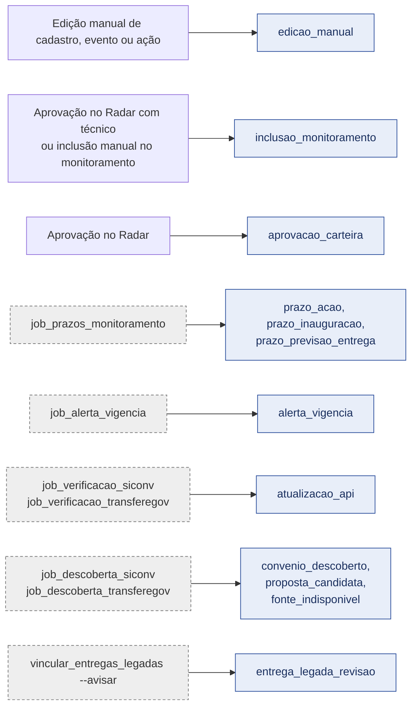

### 10.2 Quem recebe cada aviso

| Aviso | Destinatários |
|---|---|
| `edicao_manual`, `atualizacao_api`, `prazo_*`, `entrega_legada_revisao`, `inclusao_monitoramento` | Titular, suplente, gestor e admin ativos; sem técnico, só gestor e admin |
| `alerta_vigencia` | Igual ao anterior quando há instrumento monitorado; sem instrumento, só gestor e admin |
| `aprovacao_carteira`, `convenio_descoberto`, `fonte_indisponivel` | Só gestor e admin |
| `proposta_candidata` | Todos, exceto leitor (broadcast) |

Leitor nunca recebe aviso. Colaborador que não é titular nem suplente não recebe aviso de instrumento alheio.

### 10.3 Jobs, agenda e efeito

| Job | O que faz | Agenda | Estado | Grava |
|---|---|---|---|---|
| `job_prazos_monitoramento` | Avisa D-1, D0 e D+1 de ação aberta com prazo e de previsão de inauguração não realizada. Dedup por `chave_dedup`; concluir, excluir ou reagendar arquiva os avisos antigos | 08:00 de São Paulo (intenção) | **Não agendado.** Só roda à mão, com simulação por padrão e `--aplicar --confirmo-host` | `Notificacao` |
| `job_alerta_vigencia` | Convênios com fim de vigência em até 90 dias. Não repete o mesmo convênio em 30 dias | Diário no `radar_convenios.yml` (06:30 Brasília) | Só roda se a variável `ATUALIZACOES_RADAR_ATIVAS` for `true`; manual pelo `workflow_dispatch` | `Notificacao` |
| `job_verificacao_siconv` | Baixa o dump oficial do SICONV e reconcilia convênios conhecidos e instrumentos. Compara por chave estável; a primeira captura de cada convênio vira linha de base | Diário (mesmo workflow) | Mesma variável | `Convenio`, `InstrumentoEquipamento`, `Notificacao` |
| `job_verificacao_transferegov` | Consulta ao vivo cada parceria monitorada (parceria e ordens de pagamento) | Diário (mesmo workflow) | Mesma variável | Instrumento, repasse, `Notificacao` |
| `job_descoberta_transferegov` | Descobre propostas do TransfereGov de programas do Ministério da Saúde | Diário (mesmo workflow) | Mesma variável | Propostas candidatas, `Notificacao` |
| `job_descoberta_siconv` | Coleta fresca de convênios para o Radar; nunca inclui na carteira nem no monitoramento | Diário (mesmo workflow) | Mesma variável | Candidatos do Radar |
| `job_recaptura_legado_local`, `job_revalidacao_legado_local` | Recaptura oficial de um candidato e revalidação de escopo histórico | Manual | Só em clone local validado | Recaptura do candidato |
| `pipelines.yml` | Atualiza cobertura (tomógrafo, ressonância, PET-CT) e população | 06:00 Brasília | Só com `ATUALIZACOES_PIPELINES_ATIVAS=true`; fora do monitoramento interno | Dados de cobertura |
| `backup_banco.yml` | `pg_dump` cifrado com `age` para o R2, retenção de 7 dias | 02:17 e 14:17 UTC | Ligado | R2 |

Regras comuns: simulação por padrão nos scripts que gravam; `--aplicar` exige `--confirmo-host`; o aviso é criado por `criar_notificacao`, que grava o destinatário na criação (não em tempo de leitura); aviso de instrumento ou convênio fora de escopo não aparece para ninguém.

Importante para o release: nenhum agendamento foi ligado. A decisão de ligar cada um fica para depois de uma rodada supervisionada.

## 11. Registro de funcionalidades (para a equipe marcar)

Marque a coluna final com **usa**, **não usa** ou **não conheço**.

| # | Funcionalidade | Onde fica | Equipe usa? |
|---|---|---|---|
| 1 | Filtros da Mesa: busca por número, convenente, CNES ou município; contratação; CNES; UF; município; prioritário; equipamento; situação; programa; período | Mesa de trabalho | |
| 2 | Indicadores no topo da Mesa e lista de instrumentos | Mesa de trabalho | |
| 3 | Adicionar instrumento ao monitoramento | Dados oficiais | |
| 4 | Cadastro interno (técnico titular e suplente, nível, tipologia, modalidade, responsável da execução, CNES) | Detalhe | |
| 5 | Editar só o CNES | Detalhe, cabeçalho | |
| 6 | Registrar entrega com várias unidades por item | Detalhe, Equipamentos | |
| 7 | Corrigir unidade (marca, modelo, série, vida útil) | Detalhe, Equipamentos | |
| 8 | Excluir entrega com motivo | Detalhe, Equipamentos | |
| 9 | Cancelar e desfazer cancelamento de unidade | Detalhe, Equipamentos | |
| 10 | Previsão de entrega por item (definir e remover) | Detalhe, Equipamentos | |
| 11 | Confirmar repasse integral ou parcial | Detalhe, Equipamentos | |
| 12 | Vincular entrega antiga (legado) | Detalhe, Equipamentos | |
| 13 | Card de licença de operação (somente leitura) | Detalhe | |
| 14 | Documentos (6 tipos), incluindo corrigir e excluir | Detalhe, Cronograma | |
| 15 | Lançar evento de cronograma e regulatório | Detalhe, Cronograma | |
| 16 | Editar e excluir evento, com motivo | Detalhe, Eventos | |
| 17 | Ações: criar, editar, concluir, excluir, com prazo e responsável | Detalhe, Ações | |
| 18 | Concluir e reabrir acompanhamento | Detalhe, Fase | |
| 19 | Fila de revisão de itens (confirmar, corrigir, não é equipamento) | Revisão de itens | |
| 20 | Notificações por edição, prazo e vigência, com pop-up de instrumento novo | Sino | |
| 21 | Relatórios de instrumentos e repasse (Excel e Word) | Relatórios | |
| 22 | Radar: ver candidatos, rejeitar e aprovar com técnico (vai direto ao monitoramento) | Radar (gestor e admin) | |

## 12. Código sem uso

Método: busca por nome em todo o `frontend/src` e `backend` (incluindo testes). Candidato não é prova de código morto, mas todos os itens abaixo tinham **zero chamadas** fora da própria definição e foram removidos na revisão 2, depois de rodar lint, tipos e a suíte inteira.

### Removidos

| Item | Onde |
|---|---|
| `codigos_familias_com_licenca` | `repositories/documentos.py` (sobra da licença por item) |
| `listar_marcos_fase_geral_desc` | `repositories/monitoramento.py` (fase agora é calculada) |
| `preencher_ano_convenio_se_ausente` | `repositories/monitoramento.py` |
| `repositories/auditoria_marcadores.py` e seu teste | só um teste importava |
| `AjudaCampo` | `monitoramento-ui.tsx` |
| `useEntregasLegadas`, `fetchEntregasLegadas`, schema e tipo `EntregaLegada` | hook e serviço da fila de legado, sem tela |
| `TECNICOS_EQUIPE` | `lib/monitoramento-opcoes.ts` (o cadastro usa `GET /monitoramento/colaboradores`) |
| `LEGENDA_STATUS` | `lib/monitoramento-status.ts` |
| `getMapThemeColors` | `lib/theme-colors.ts` |
| `equipamentosDaProposta` | `lib/proposta-metas-resumo.ts` |
| Tipos `ProgramaTransfereGov`, `ConvenioPortal`, `ComponentePropostaApi`, `ComponenteOncologia` | `types/monitoramento.ts` |
| `CandidatoLegadoProvaResumo` e a conferência com checkbox e justificativa | Radar, substituídos pela aprovação com técnico |

### Mantidos, para a equipe decidir

| Item | Motivo |
|---|---|
| Rota `/monitoramento-equipamentos/entradas` | Só redireciona; mantida por links antigos |
| `GET /monitoramento/entregas-legadas` (backend) | Sem consumidor de tela depois da remoção do hook; o vínculo é feito item a item |
| Exports só usados em testes (`mediaReferenciaFase`, `formatarNup`, `codificarSituacao`) | Têm teste próprio; remover só se a funcionalidade sair |
| Exports usados só no próprio arquivo (`motivoExclusaoSchema`, `unidadeEntregaSchema`, `itemEntregaSchema`, `conclusaoKeys`, `documentosKeys`) | Só o `export` está sobrando |
| `EtapaExpandida`, `PropostaExpandida` | Ainda referenciados por outros tipos do mesmo arquivo |
| Scripts de uma só execução | Arquivar depois do release (lista abaixo) |

### Scripts de uma só execução (arquivar depois do release)

`migrar_marcos_para_documentos`, `migrar_concluidos_para_conclusao`, `migrar_eventos_inauguracao_prevista`, `remover_persus_ii_do_monitoramento`, `corrigir_entregas_persus_i`, `consolidar_eventos_marco_duplicados`, `vincular_entregas_legadas`, `derivar_repasses_siconv`, `projetar_itens_plano` (este também serve de rotina recorrente), `preencher_*`, `importar_planilha_monitoramento`, `importar_programas_monitoramento`. Depois do release e da conferência em produção, mover para `scripts/arquivo/` ou remover, mantendo o histórico no git.

Pendente já registrado no plano do fluxo: remover a leitura do evento antigo `fase_concluido` em `fatos_do_instrumento` e `fases_calculadas_em_lote` depois de conferir a produção.

## 13. Limites desta análise

- Busca textual, não análise de grafo de chamadas: função chamada por nome dinâmico ou por reflexão não seria detectada. Por isso a remoção foi validada por lint, tipos e testes.
- Endpoints foram cruzados com o frontend pelo caminho; endpoint usado só por script externo apareceria como "com consumidor" se o texto coincidir.
- Uso real em produção não foi medido. Para isso, olhar `AuditLog` por tipo de ação (quem lançou o quê, quando) é o melhor indicador de funcionalidade que a equipe não usa.
- A agenda dos jobs reflete os arquivos de workflow. O valor das variáveis `ATUALIZACOES_*_ATIVAS` no GitHub não foi consultado.
