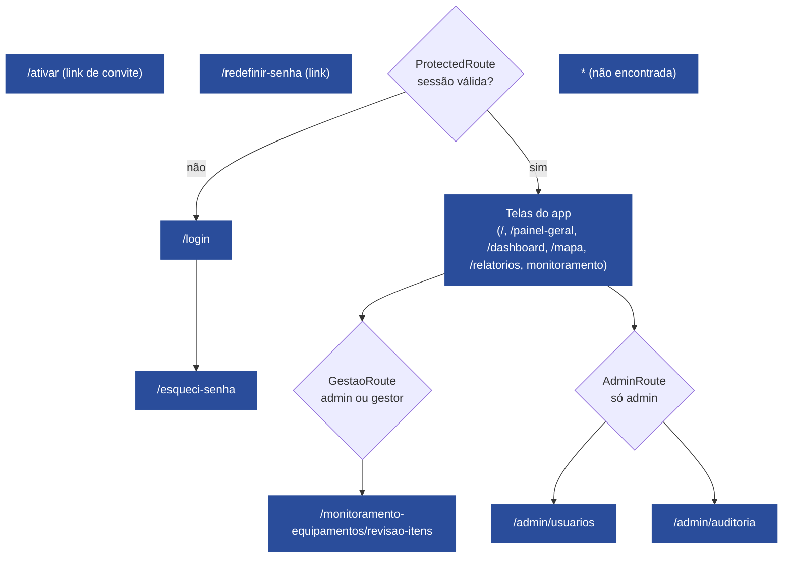
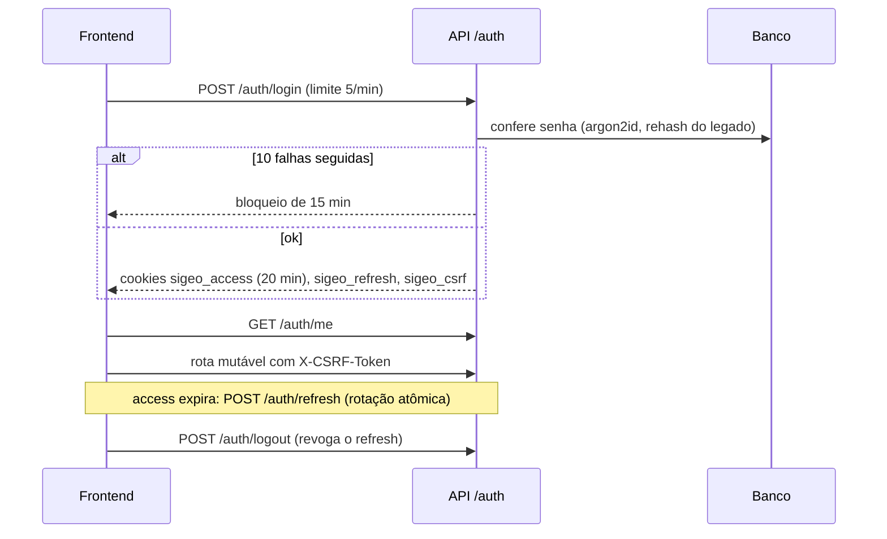
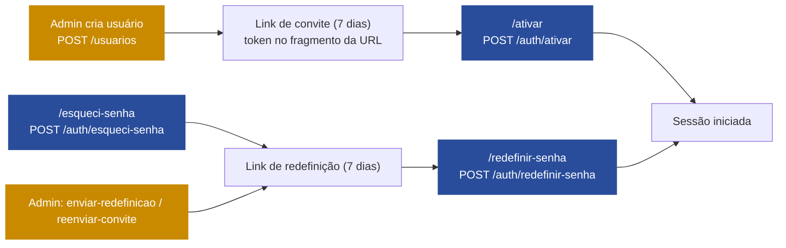
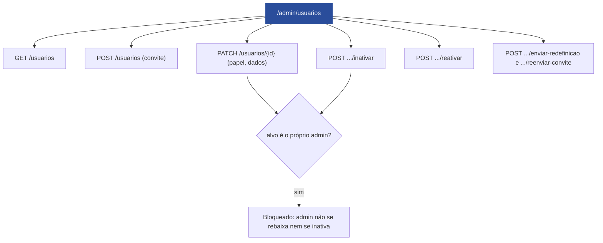
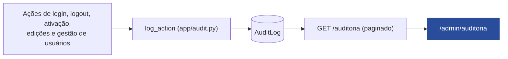

# Mapa de acesso e administração (revisão 1, de 27/11/2026)

## Objetivo e escopo

Login, ativação de conta, recuperação de senha, sessão por cookies, guardas de rota, gestão de usuários e auditoria. Lido de `frontend/src/App.tsx`, `routers/auth.py`, `routers/usuarios.py`, `routers/auditoria.py` e `services/usuarios.py`.

## 1. Telas e guardas de rota

## 2. Login, sessão e renovação

Idle de 2 h e teto absoluto de 24 h encerram a sessão. O `http-client.ts` serializa o refresh com mutex e repete a chamada uma vez.

## 3. Convite, ativação e redefinição

## 4. Gestão de usuários (só admin)

Papéis: `admin`, `gestor`, `colaborador`, `leitor`.

## 5. Auditoria

Ações de acesso gravadas: `login_sucesso`, `login_falha`, `login_bloqueado`, `logout`, `conta_ativada`.

## Registro de funcionalidades

| Funcionalidade | Onde | Estado |
| --- | --- | --- |
| Login com bloqueio e rate limit | `/auth/login` | ativo |
| Ativação, esqueci/redefinir senha | `/auth/*` | ativo |
| Gestão de usuários | `/usuarios` | ativo, só admin |
| Auditoria paginada | `/auditoria` | ativo, só admin |

## Código sem uso

Nada identificado nesta leitura.

## Limites desta análise

> [!warning] A confirmar
> A redefinição de senha (`/auth/redefinir-senha`) não foi vista gravando `AuditLog`. Filtros e colunas da tela de auditoria não foram detalhados. Texto de e-mail de convite não foi lido.
