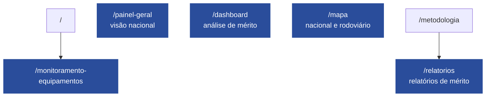
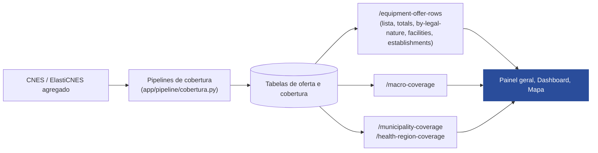
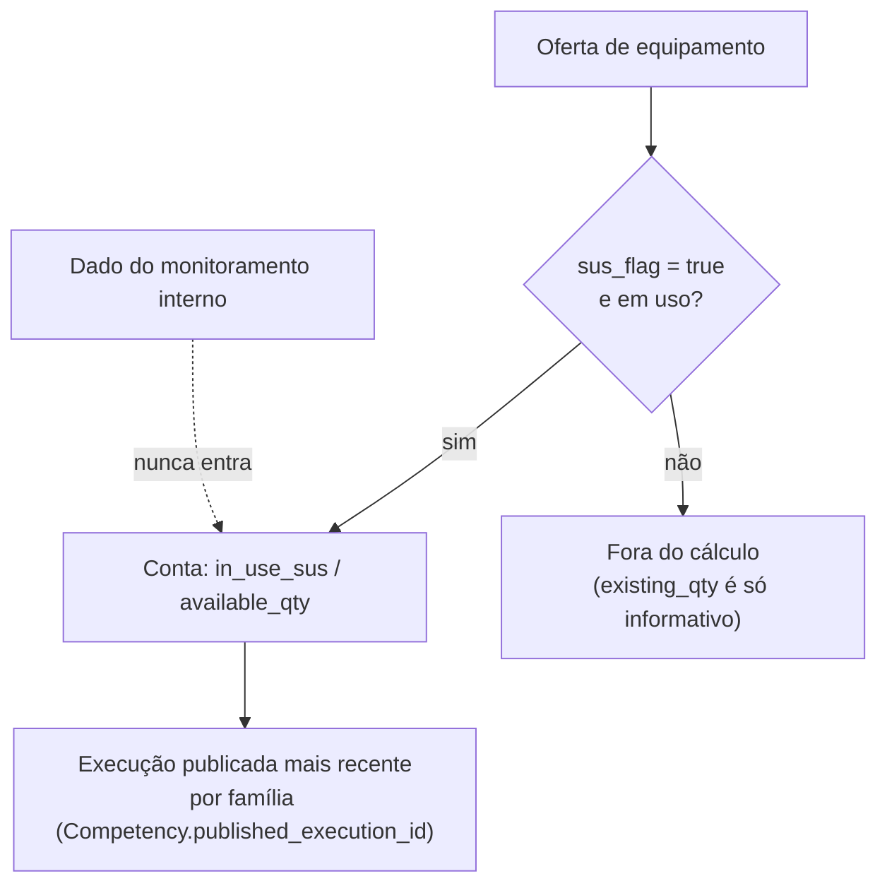

# Mapa da análise de mérito (revisão 1, de 27/11/2026)

## Objetivo e escopo

Telas de cobertura assistencial: Painel geral, Dashboard, Mapa e Relatórios de mérito. Sistema separado do monitoramento interno. Fonte da regra de cálculo: `docs/metodologia-parametros.md`.

## 1. Telas e navegação

Painel geral fica fora do `AppLayout`; Dashboard, Mapa e Relatórios ficam dentro dele. Todas exigem login.

## 2. De onde vêm os dados

## 3. Regras que valem em todas as telas

Produtividade de Acelerador Linear, Ultrassom e Mamógrafo é placeholder sem valor normativo. Município é filtrado em Python com `normalizar_texto`.

## 4. Relatórios de mérito

Os relatórios do monitoramento (Equipamentos, Instrumentos, Propostas) são outro fluxo, descrito em [relatorios.md](relatorios.md).

## Registro de funcionalidades

| Funcionalidade | Onde | Estado |
| --- | --- | --- |
| Painel geral | `/painel-geral` | ativo |
| Dashboard de mérito | `/dashboard` | ativo |
| Mapa nacional e rodoviário | `/mapa` | ativo |
| Relatórios de mérito | `/relatorios` | ativo |
| `/metodologia` | redireciona a `/relatorios` | ativo |

## Código sem uso

Nada identificado nesta leitura.

## Limites desta análise

> [!warning] A confirmar
> Lista exata de filtros e indicadores de cada tela não foi mapeada aqui; o desenho acima mostra só a origem dos dados e as regras. Qual endpoint alimenta cada card não foi conferido um a um.
