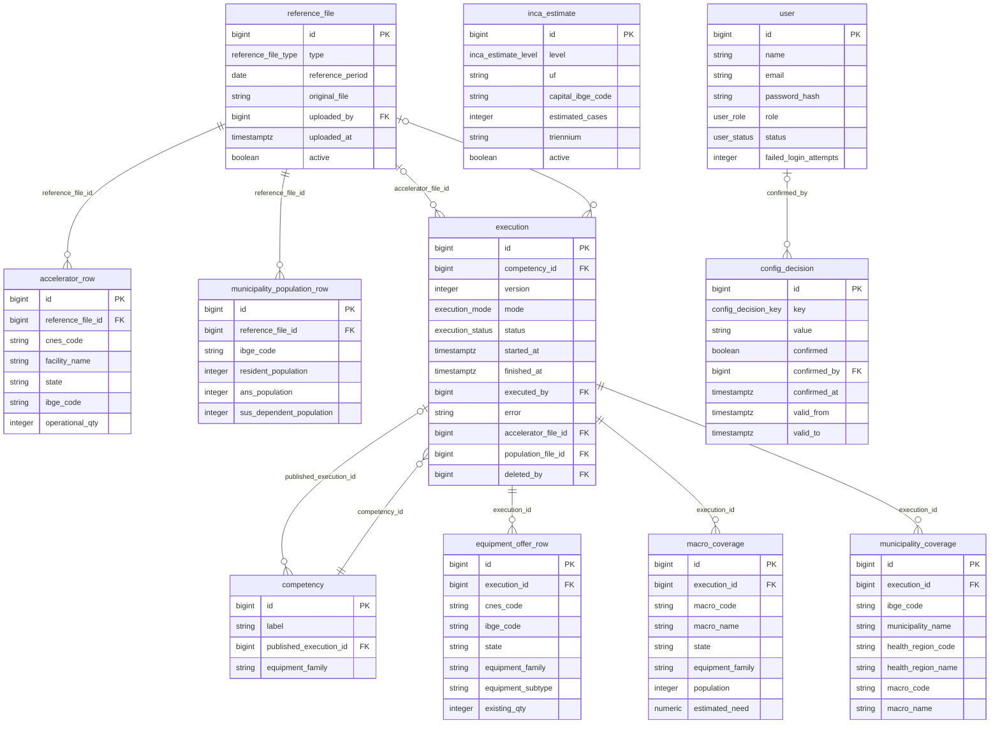
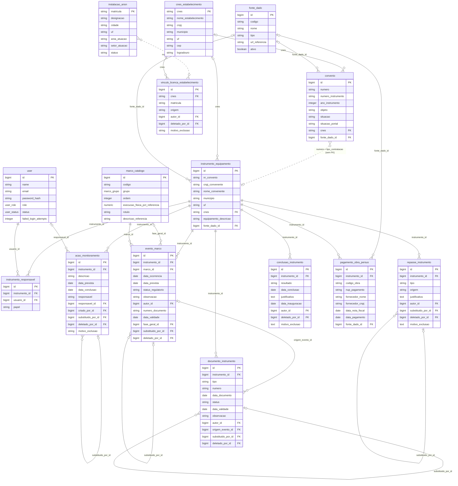
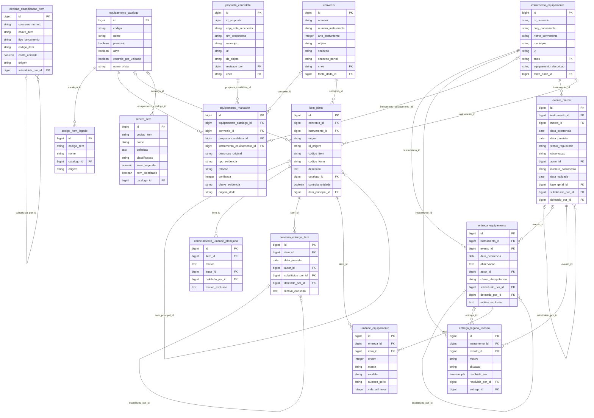
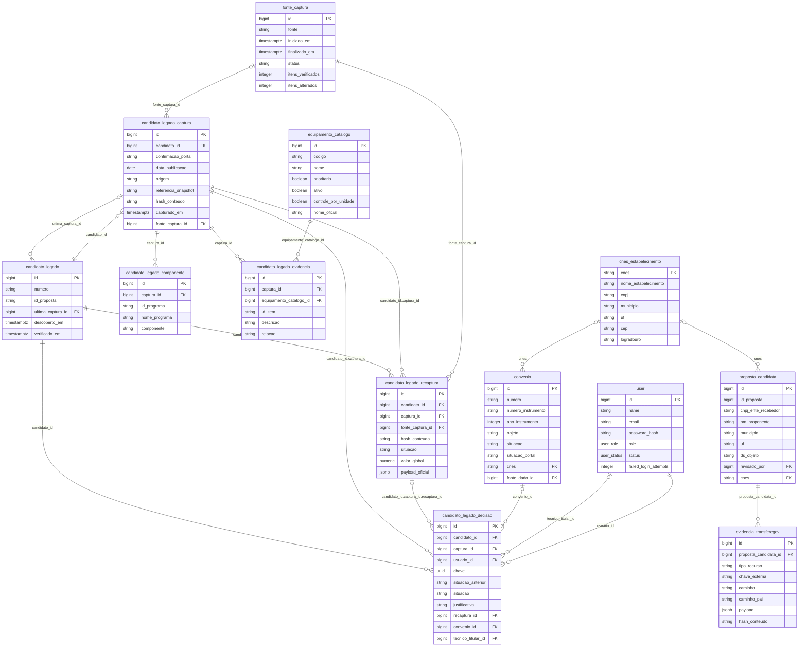
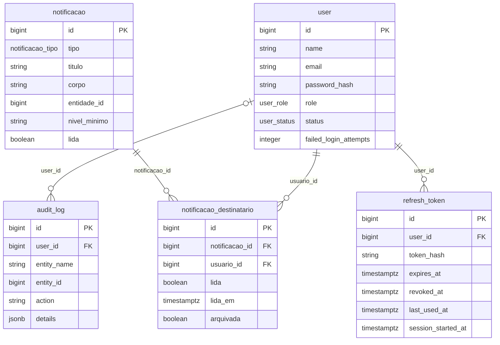

# Mapa do banco de dados (revisão 2, de 23/11/2026)

Objetivo: dar uma visão única das 50 tabelas do schema e de como elas se ligam, para a equipe validar o modelo e apontar o que está sem uso. Gerado a partir do schema real no head `d9e0f1a2b3c4` (cópia de ensaio `sigeo_ensaio_release_20261122`): 50 tabelas, 596 colunas e 98 chaves estrangeiras. Produção está no head `d9e0f1a2b3c4` desde 23/11/2026 (conferido em `alembic_version`); as 7 tabelas marcadas com asterisco chegaram junto, e a revisão 2 não mudou o schema. Os diagramas usam Mermaid e renderizam no Obsidian, no GitHub e no VS Code.

Cada entidade mostra só a chave primária, as chaves estrangeiras e até 6 colunas de negócio. O detalhe de todas as colunas fica para o dicionário de dados. `autor_id` e `deletado_por_id` apontam para `user` em todas as tabelas append-only e foram omitidos das relações para não poluir o desenho. Outras relações com `user` também ficaram de fora quando só registram quem executou ou revisou (por exemplo `execution.executed_by`, `reference_file.uploaded_by`, `proposta_candidata.revisado_por`). Nas relações desenhadas, `|o` no lado do pai significa chave estrangeira que aceita nulo.

## 1. Como o banco se divide

| Domínio | Tabelas | Quem escreve |
| --- | --- | --- |
| Cobertura (análise de mérito) | `reference_file`, `accelerator_row`, `municipality_population_row`, `competency`, `execution`, `equipment_offer_row`, `macro_coverage`, `municipality_coverage`, `inca_estimate`, `config_decision` | Pipelines de cobertura |
| Carteira e monitoramento | `convenio`, `instrumento_equipamento`, `instrumento_responsavel`, `marco_catalogo`, `evento_marco`, `acao_monitoramento`, `repasse_instrumento`\*, `documento_instrumento`\*, `conclusao_instrumento`\*, `pagamento_obra_persus`, `vinculo_licenca_estabelecimento`\*, `instalacao_ansn`\*, `fonte_dado`, `cnes_estabelecimento` | Cargas, jobs do SICONV e equipe |
| Itens e entregas | `item_plano`, `entrega_equipamento`, `unidade_equipamento`, `cancelamento_unidade_planejada`\*, `previsao_entrega_item`\*, `entrega_legada_revisao`, `decisao_classificacao_item`, `equipamento_catalogo`, `renem_item`, `codigo_item_legado`, `equipamento_marcador` | Equipe e scripts de classificação |
| Radar | `fonte_captura`, `candidato_legado`, `candidato_legado_captura`, `candidato_legado_componente`, `candidato_legado_evidencia`, `candidato_legado_recaptura`, `candidato_legado_decisao`, `proposta_candidata`, `evidencia_transferegov` | Job de descoberta, recaptura e gestão |
| Acesso e avisos | `user`, `refresh_token`, `audit_log`, `notificacao`, `notificacao_destinatario` | Aplicação |

\* Tabela criada no release de 22/11/2026 (migrations até `d9e0f1a2b3c4`); já está em produção.

Fora dos domínios: `alembic_version`, controlada pelo Alembic.

## 2. Cobertura

Cada família de equipamento tem uma `competency` e várias `execution`; a competência aponta a execução publicada (`published_execution_id`). Os resultados (`macro_coverage`, `municipality_coverage`, `equipment_offer_row`) pertencem a uma execução. `cnes_estabelecimento` não aparece aqui: a cobertura usa o CNES agregado nas linhas de oferta e não por chave estrangeira.

## 3. Carteira e monitoramento

`convenio` (a fonte oficial do SICONV) e `instrumento_equipamento` (o que a equipe monitora) **não têm chave estrangeira entre si**: a ligação é por `numero` e `tipo_contratacao`. Convênio sem monitoramento é o caso normal. `evento_marco` (histórico com catálogo fixo) e `acao_monitoramento` (tarefa livre) são append-only: "editar" cria o registro corrigido e aponta o antigo por `substituido_por_id`; "excluir" é soft delete com motivo.

## 4. Itens e entregas

O plano de aplicação do SICONV vira `item_plano` (um equipamento distinto por linha). A entrega é append-only e gera `unidade_equipamento` para as famílias com controle por unidade ou valor unitário acima do limite. `equipamento_catalogo` é o catálogo das famílias; `renem_item` e `codigo_item_legado` o alimentam. `decisao_classificacao_item` guarda a decisão de classificação por `convenio_numero` e `chave_item`, sem chave estrangeira. Em `conta_unidade`, nulo significa que a equipe não afirmou controle (a projeção aplica a regra de valor e a exceção do instrumento) e `false` é decisão explícita de não controlar. `convenio.fora_escopo_equipamentos` esconde o convênio de tudo (obra e serviço, ou órgão que não é o Ministério da Saúde).

## 5. Radar de instrumentos

Cada rodada do job grava uma `fonte_captura`. O candidato (`candidato_legado`) tem capturas sucessivas; a decisão e a recaptura referenciam a captura por chave composta (candidato, captura), o que impede ligar prova a candidato errado. A decisão aprovada aponta o `convenio` criado e o técnico titular.

## 6. Acesso e avisos

`notificacao` não tem chave estrangeira para o objeto avisado: `entidade_id` aponta, conforme o `tipo`, para um instrumento, convênio, proposta ou candidato. Quem vê cada aviso está em `notificacao_destinatario` (lida e arquivada por usuário). `Notificacao.lida` está deprecated em favor dessa tabela.

## 7. Ligações sem chave estrangeira

| De | Para | Como liga |
| --- | --- | --- |
| `instrumento_equipamento` | `convenio` | `nr_convenio` = `numero` e mesmo `tipo_contratacao` (padrão "Convênio") |
| `decisao_classificacao_item` | `convenio` | `convenio_numero` |
| `decisao_classificacao_item` | `item_plano` | `convenio_numero` + `chave_item` (`ID_ITEM_PAD` do SICONV ou hash do texto na carga manual) |
| `notificacao` | instrumento, convênio, proposta ou candidato | `entidade_id` conforme `tipo` |
| `instalacao_ansn` | `vinculo_licenca_estabelecimento` | `matricula` |
| `candidato_legado` | `convenio` | `numero` (a aprovação grava `convenio_id` na decisão) |

## 8. Estado de uso das tabelas (produção, 22/11/2026, contagem exata)

As estatísticas do Neon (`n_live_tup`) estão defasadas e não foram usadas.

| Situação | Tabelas |
| --- | --- |
| Núcleo ativo | `convenio` (560), `instrumento_equipamento` (427), `evento_marco`, `acao_monitoramento`, `item_plano`, `entrega_equipamento`, `unidade_equipamento`, `notificacao`, `notificacao_destinatario`, `user` (23), `refresh_token`, `audit_log`, `cnes_estabelecimento` (635.113), as tabelas do Radar |
| Só carga ou pipeline, sem leitura pelo app | `accelerator_row` (0), `inca_estimate` (0), `municipality_population_row` (11.140), `reference_file` (2), `fonte_dado` (6), `pagamento_obra_persus` (204) |
| Legada, sem uso pelo app | `entrega_legada_revisao` (3) |
| Vazia por desenho ainda | `candidato_legado_recaptura` (0; a recaptura nunca rodou em produção) |

> [!warning] A confirmar
> O relatório de limpeza (próximo passo) decide caso a caso. Nada foi removido nem alterado por este mapa.
