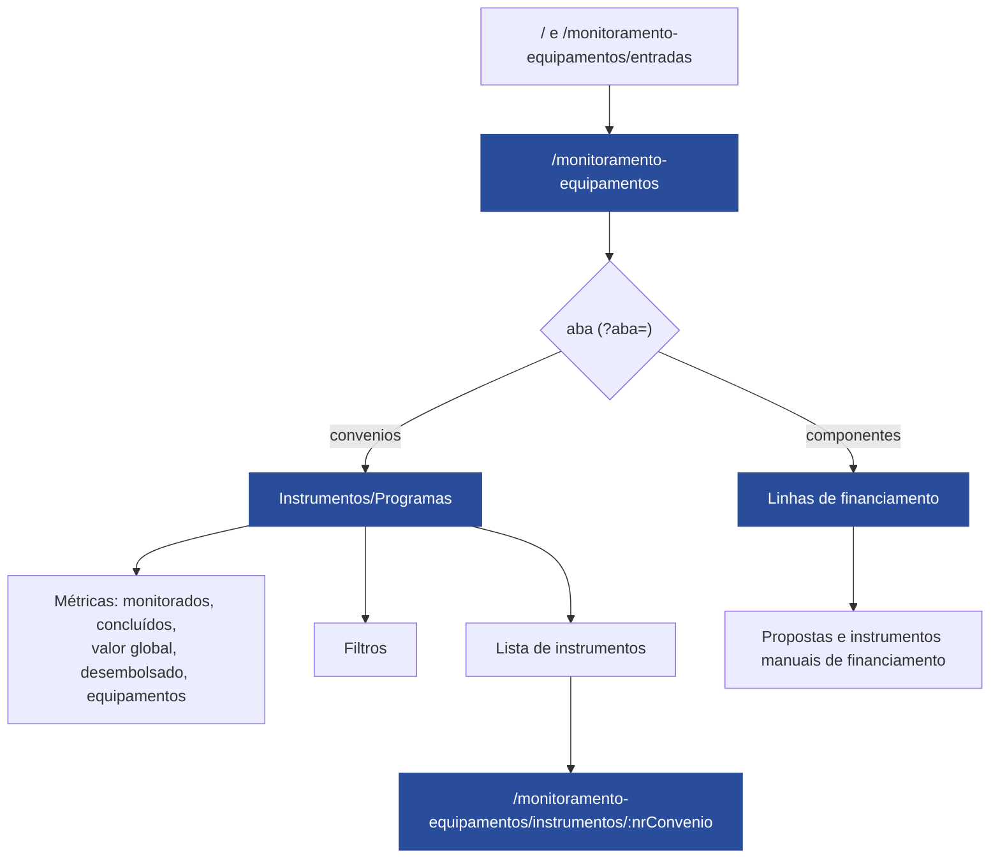
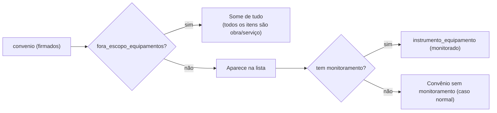

# Mapa de Dados oficiais (revisão 1, de 27/11/2026)

## Objetivo e escopo

Página `/monitoramento-equipamentos` (destino de `/`): instrumentos firmados e linhas de financiamento. Lido de `monitoramento-equipamentos-page.tsx` e `components/features/dados-oficiais-*.tsx`.

## 1. Estrutura da página

A aba Instrumentos/Programas mostra o total de instrumentos; a aba Linhas de financiamento mostra o total de linhas.

## 2. Escopo dos instrumentos

Tipos de contratação: Convênio, FAF, TED, PERSUS I, PERSUS II.

## Registro de funcionalidades

| Funcionalidade | Onde | Estado |
| --- | --- | --- |
| Aba Instrumentos/Programas | `?aba=convenios` | ativo |
| Aba Linhas de financiamento | `?aba=componentes` | ativo |
| Métricas e filtros | `dados-oficiais-*` | ativo |

## Código sem uso

Nada identificado nesta leitura.

## Limites desta análise

> [!warning] A confirmar
> Endpoint exato que alimenta cada aba, lista de filtros e cálculo de cada métrica não foram detalhados. O redirecionamento de `/entradas` foi lido em `App.tsx`.
