# Mapa do Monitoramento interno (revisão 6, de 24/11/2026)

Objetivo: servir de base para a equipe validar o fluxo e apontar funcionalidade ou código sem uso. Tudo aqui foi lido do código da branch `feat/persus-ii-fora-do-monitoramento` (estado de 21/11/2026, depois da revisão 3). Os diagramas usam Mermaid e renderizam no Obsidian, no GitHub e no VS Code.

Escopo: Mesa de trabalho (`/monitoramento-equipamentos/instrumentos`), detalhe do instrumento (`/monitoramento-equipamentos/instrumentos/:nr`), Radar de instrumentos e fila de revisão de itens. O Painel de gestão e o Meu painel entram na seção 14 (a flag `PAINEL_GESTAO_HABILITADO` está `true` na branch de trabalho).

Mudanças da revisão 6: seção 14 (Painel de gestão e Meu painel: filtros mínimos, regras de situação do equipamento, cancelamento de unidade planejada, valor global).

Mudanças da revisão 4: Radar mostra o candidato antes do Portal (Aprovar segue travado); card separa "Descoberto em" e "Recaptura"; Aprovar exige prova vigente; política de avisos do SICONV com resumo e popup de detalhe. Detalhes no mapa do Radar.

Mudanças da revisão 3: entrega manda no evento de cronograma; conclusão com trava por instrumento e leitura depois da trava; ações lidas por instrumento (pendentes primeiro, contadores do conjunto inteiro); aprovação do Radar exige titular; revisão de itens confere a situação esperada; contrato de licença e conclusão detalhados.

Mudanças da revisão 2: instrumento concluído trava todas as edições; as 16 famílias entram no diagrama de itens; exceções de itens, entregas e unidades listadas; Radar só para gestor e admin, com card enxuto e aprovação com técnico; jobs detalhados; código sem uso removido.

## 1. Telas e navegação

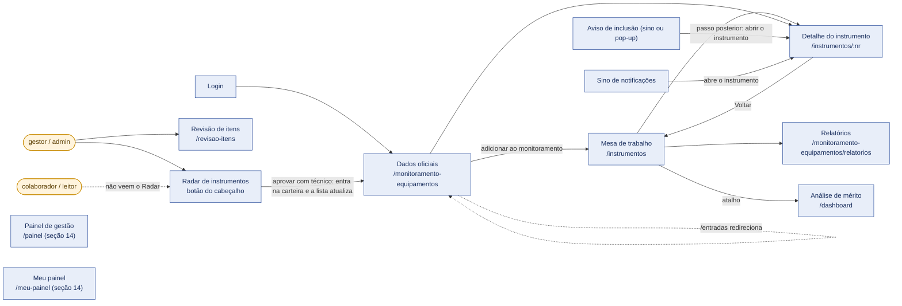

Detalhes de navegação: o retorno da Mesa preserva filtros e paginação (`navegacao-retorno`). Instrumento sem acompanhamento (timeline 404) mostra só "Ainda não monitorado internamente", sem alerta de erro, e as consultas dependentes (ações) nem são disparadas. Falha real de consulta mostra alerta com mensagem segura e "Tentar novamente".

## 2. Estrutura da página de detalhe

Cada bloco é um componente em `frontend/src/components/features/`. A linha tracejada mostra de onde vêm os dados. Com o acompanhamento **concluído**, todos os blocos ficam somente leitura, exceto "Concluir / Reabrir" (ver seção 5).

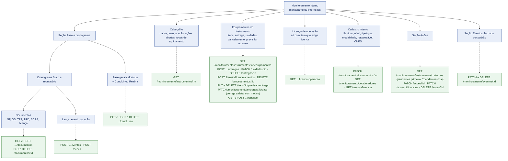

## 3. Fase do acompanhamento (calculada, nunca escolhida)

A fase sai de fatos acumulados (`services/fase_acompanhamento.py`). O fato mais avançado decide. Atualização externa não faz a fase regredir.

```mermaid
stateDiagram-v2
    direction LR
    [*] --> AcompanhamentoIniciado
    AcompanhamentoIniciado --> AguardandoRepasse: repasse previsto
    AguardandoRepasse --> ValorRepassado: repasse confirmado
    AcompanhamentoIniciado --> ValorRepassado: repasse confirmado
    ValorRepassado --> EmAquisicao: licitação ou contrato ou fabricação realizada
    EmAquisicao --> EquipamentoEntregue: entrega lançada
    ValorRepassado --> EquipamentoEntregue: entrega sem repasse também avança
    AcompanhamentoIniciado --> EquipamentoEntregue: idem
    EquipamentoEntregue --> PosEntrega: instalação, comissionamento, treinamento ou operação
    PosEntrega --> Concluido: conclusão confirmada pela equipe
    EquipamentoEntregue --> Concluido: conclusão confirmada
    Concluido --> FaseCalculada: reabertura com motivo recalcula a fase dos fatos
    FaseCalculada --> [*]
```

Reabrir não devolve a uma fase fixa: a fase volta a ser a mais avançada que os fatos sustentam (por exemplo Equipamento entregue, se há entrega, ou Pós-entrega, se há marco pós-entrega).

Nomes na tela: Acompanhamento iniciado, Aguardando repasse, Valor repassado, Em aquisição, Equipamento entregue, Pós-entrega, Concluído.

### Marcos do cronograma liberados por fase (`marcos_por_fase.py`)

| Grupo de marcos | Liberado a partir de | Até |
|---|---|---|
| Fabricação, chegada ao Brasil, desembaraço | Valor repassado | Em aquisição |
| Obra e reforma | Acompanhamento iniciado | Equipamento entregue |
| Instalação, comissionamento, treinamento, início da operação | Equipamento entregue | Pós-entrega |
| Em Concluído | nada se lança (reabrir antes) | |

Fora da janela a opção aparece desabilitada com o motivo, e o backend recusa com 422. Vale só para lançamento novo, não para correção.

## 4. Itens, entregas e unidades

### 4.1 As 16 famílias com controle por unidade

Item de aquisição de uma destas famílias é monitorado por unidade e define "Prioritário"; item ainda pendente na fila de revisão não controla até ser decidido. Quatro delas exigem licença de operação (ANSN); Cobalto e Radioterapia também exigem, mas não têm controle por unidade.

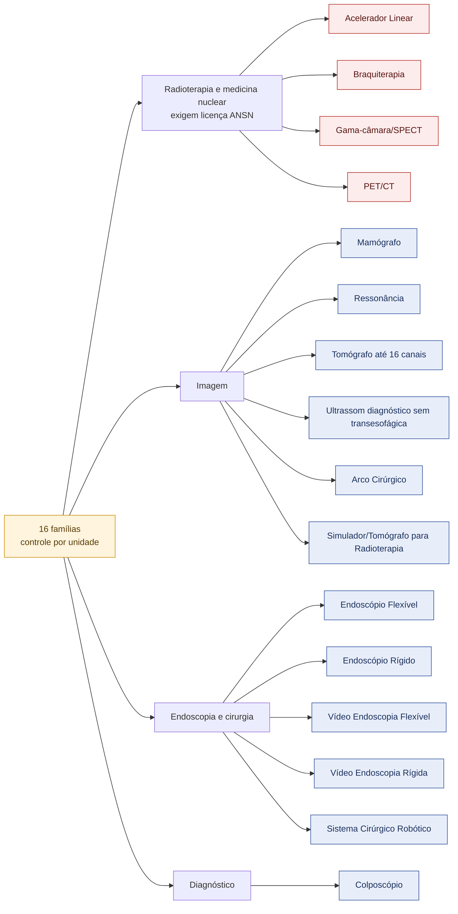

Os agrupamentos (radioterapia, imagem, endoscopia) são só para leitura do diagrama; o sistema trata as 16 igualmente.

### 4.2 Fluxo do item

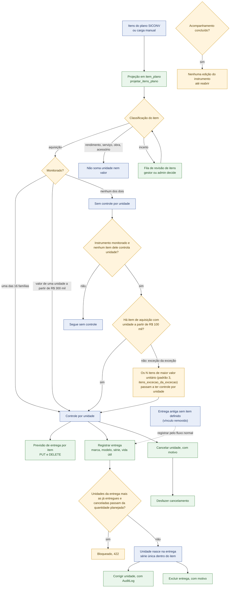

### 4.3 Exceções e travas (lidas do código)

| Situação | O que acontece | Onde |
|---|---|---|
| Entrega passa do planejado | Compara **quantidade**, não data: unidades novas maiores que `planejado − já entregue − canceladas` dão 422 | `entregas_equipamento._validar_itens` |
| Data da entrega no futuro | 422 | `registrar_entrega` |
| Instrumento monitorado sem nenhum item controlado | Entrou pelo componente: entre as **aquisições com classificação aplicada e valor**, as cuja unidade vale **R$ 100 mil ou mais** passam a ter controle por unidade, para a entrega poder ser lançada. O limite é configurável (`limite_valor_unitario_excecao`) | `projetar_itens_plano._aplicar_excecao_instrumento` |
| Nenhum item chega a R$ 100 mil (exceção da exceção) | Os **N itens de maior valor unitário** (padrão 3, configurável em `itens_excecao_da_excecao`) viram controle por unidade; só concorrem os mesmos candidatos acima | `projetar_itens_plano._aplicar_excecao_instrumento` |
| Equipamento fora das 16 famílias | Regra geral: monitorado por item só se a unidade vale **R$ 300 mil ou mais** (`limite_valor_unitario_monitorado`, configurável); valor da unidade = valor do item no plano ÷ quantidade. As duas exceções acima só valem para instrumento sem nenhum item controlado | `classificacao_itens`, `projetar_itens_plano` |
| Item sem quantidade planejada | Exige confirmar a quantidade entregue; não permite cancelar unidade | `_validar_itens`, `cancelamento_unidade` |
| Item não controlado por unidade | Entrega recusada. O teste final é `controla_unidade` do item, que pode ser verdadeiro por família, por valor ou por uma das exceções acima | `_validar_itens` |
| Item de outro instrumento ou inativo | Tratado como inexistente, sem vazar que existe | `_validar_itens` |
| Mesmo item duas vezes na entrega | 422 | `_validar_itens` |
| Entrega sem item vinculado | 422: toda entrega liga ao menos um item | `_validar_itens` |
| Número de série repetido | 422 na mesma entrega, 409 se já existe no item | `_limpar_series`, `_validar_itens` |
| Reenvio da mesma entrega | Idempotente pela `chave_idempotencia`; chave de outro instrumento dá 409 | `registrar_entrega` |
| Unidade com entrega excluída | Não pode ser corrigida | `corrigir_unidade` |
| Excluir entrega | Exige motivo; entrega já excluída dá 422 | `excluir_entrega` |
| Cancelamento | Exige unidade pendente; já desfeito dá 409 | `cancelamento_unidade` |
| Rendimento de aplicação | Não soma unidade nem valor; aparece como linha filha do item principal | `classificacao_itens` |
| Carga manual | Não tem valor, então não entra na regra de R$ 300 mil | `classificacao_itens` |
| Decisão da equipe na fila de revisão | Prevalece sobre a regra automática. **Confirmar grava `conta_unidade = true` só quando a família controla unidade; sem família grava nulo**, e a projeção do convênio roda logo depois. Gravar `false` seria "a equipe decidiu não controlar" e escondia a regra de R$ 300 mil e a exceção (caso 949415, hemodinâmica de R$ 3,3 mi por unidade). Alcance de `false`: bloqueia a regra automática de R$ 300 mil, mas a seleção da exceção do instrumento não consulta a decisão | `classificacao_itens_plano.decidir`, `decisao_classificacao_item` |
| Criar instrumento monitorado (Mesa ou aprovação do Radar) | Liga os itens soltos ao instrumento **e projeta o plano na mesma transação**, para a exceção de R$ 100 mil valer nos dois caminhos. Só ligar não bastava (caso 970368) | `monitoramento_instrumentos.criar_instrumento_monitorado_sem_commit` |
| Fila de revisão de itens | Não lista item de convênio fora de escopo | `classificacao_itens_plano.listar_fila` |
| Decisão sobre item que mudou desde a leitura | 409: a decisão informa a situação esperada (`situacao_esperada`, padrão pendente); em item de instrumento concluído, 409 "reabra" (decidir muda `controla_unidade`) | `classificacao_itens_plano.decidir` |
| Convênio com todos os itens obra ou serviço, ou de órgão que não é o Ministério da Saúde | `fora_escopo_equipamentos=true`: some de tudo. Em 23/11/2026 foram marcados o 880090 (Ministério das Mulheres) e o 725685 (UFPE); as demais unidades gestoras (FNS e CEF-Programas do MS) são do Ministério da Saúde | `instrumento_no_escopo()` |
| PERSUS II | Fora do monitoramento interno | `criar_instrumento_monitorado` |
| Acompanhamento concluído | Nada pode ser alterado até reabrir (seção 5) | `assert_nao_concluido` |

### 4.4 Entrega antiga sem item definido (função removida)

**O que mudou.** A função de vincular entrega antiga a um item foi removida do SISGEO: não há mais endpoint, botão, situação "A vincular" nem script `vincular_entregas_legadas`. Eram poucos casos (no dump de 20/11/2026, 3 pedidos em 2 instrumentos: 953739 e 949415).

**Como esses instrumentos concluem.** Eles seguem o fluxo normal: registrar a entrega pelos itens (marca, modelo, série, vida útil) e concluir o acompanhamento. O pedido antigo deixa de ser impedimento da conclusão. Os eventos de entrega antigos continuam no histórico de eventos.

**O que fica no banco.** A tabela `entrega_legada_revisao` e o tipo de aviso `entrega_legada_revisao` ficam só como histórico, sem uso pela aplicação. Apagá-los é uma migration em produção, a fazer depois, com backup e autorização.

## 5. Concluir e reabrir o acompanhamento

"Concluído" e "Concluir acompanhamento" são a mesma coisa: a fase Concluído existe quando há conclusão confirmada. Enquanto a migração dos concluídos antigos (`migrar_concluidos_para_conclusao`) não roda em produção, o evento antigo `fase_concluido` também vale como concluído, com a mesma trava, e Reabrir também o desfaz. Nesse caso a tela já mostra "Reabrir" (a avaliação da conclusão reconhece o evento antigo). Se o evento antigo não tem data (6 em produção, 22/11/2026), a API devolve `data_conclusao` nula e a tela mostra "Concluído (data não registrada)", em vez da data do dia; a migração manda esses casos para revisão. Reabrir desfaz a conclusão confirmada **e** o evento antigo, mesmo quando os dois coexistem (caso dos instrumentos migrados).

A avaliação da tela é lida de novo ao abrir o diálogo e invalidada por qualquer mutação que mude os impedimentos (ação, entrega, unidade, previsão, evento), então o botão não fica bloqueado por um resultado antigo. A decisão final é sempre do servidor, que revalida no POST.

Regra: com o acompanhamento **concluído**, o instrumento inteiro fica travado para edição. A única ação liberada é **reabrir** (com motivo). Isso vale para cadastro, entregas, unidades, cancelamentos, previsões, repasse, eventos, ações e documentos.

**Inauguração na conclusão (opcional).** Ela não é obrigatória. A pergunta "precisa de inauguração?" é feita ao registrar a entrega (sim grava a previsão, não grava "dispensada"). Ao concluir, o campo de data só aparece quando a inauguração ainda não aconteceu nem foi dispensada; em branco, nada é criado. Informada, a data vira a inauguração realizada do cronograma (substitui a previsão, na mesma transação) e o cabeçalho passa a mostrar "Inaugurado". Não pode estar no futuro nem depois da conclusão; com inauguração dispensada ou já realizada em outra data, a API recusa. Reabrir não apaga a inauguração. Depois de concluído o instrumento fica travado, então a data só se corrige reabrindo.

Formas de confirmar a inauguração: (1) editar o evento de inauguração existente na seção Eventos, preenchendo a data de ocorrência; (2) informar a data ao concluir. A pergunta da entrega só registra previsão ou dispensa.

Ordem para os PERSUS I que tinham conclusão antiga: `corrigir_entregas_persus_i` lança a entrega com a data da inauguração e depois `concluir_persus_i_pela_inauguracao` conclui o acompanhamento com `data_conclusao` e `data_inauguracao` iguais a essa data, só quando não sobra impedimento e o resultado é integral. No clone de 20/11/2026 isso concluiu 17 instrumentos; ficam fora os sem inauguração realizada (3) e o que nunca foi concluído (PS1-248225). Em produção só com autorização, após backup.

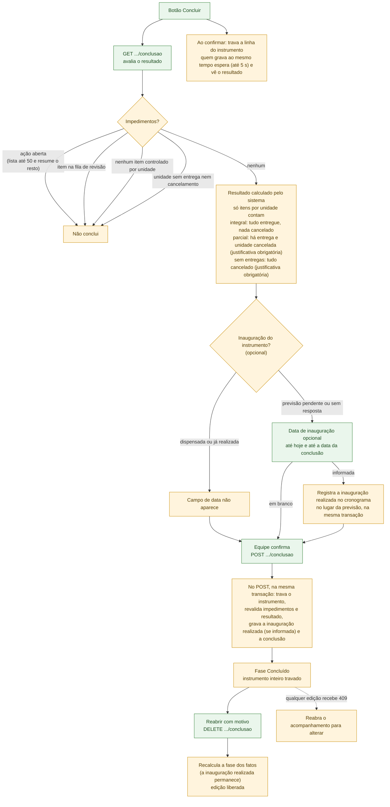

## 6. Licença de operação (por estabelecimento CNES)

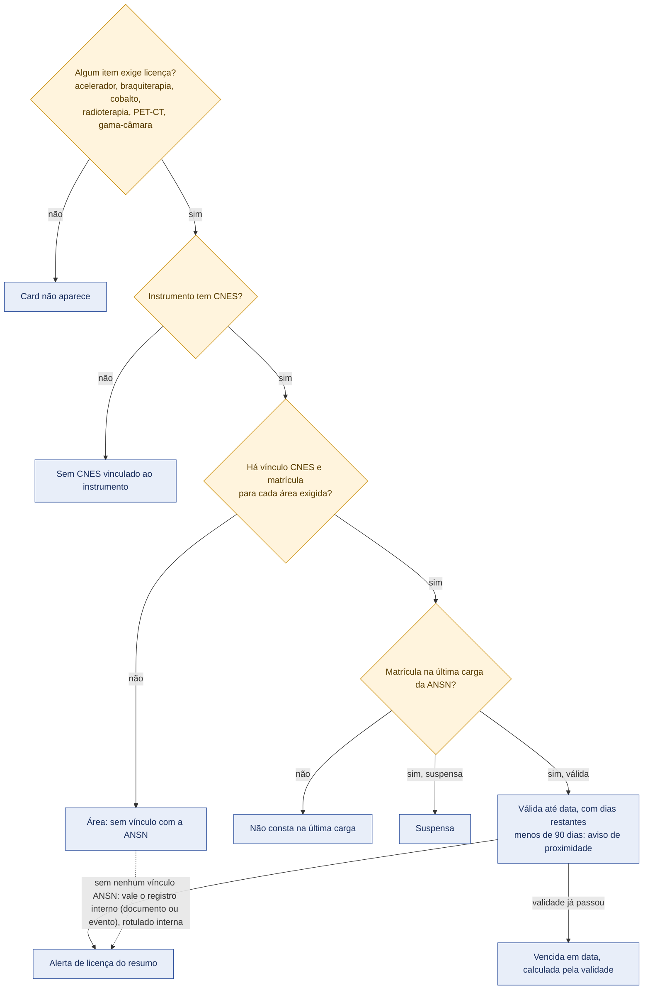

A fase do instrumento não depende da licença: o card só informa, e o estado nunca é escolhido por usuário (vem da última carga da ANSN). O estado "não consta na última carga" é diferente de "vencida": a primeira é ausência da matrícula na carga, a segunda vem da data de validade. Matrícula ausente da carga não aciona o registro interno enquanto o vínculo existir.

A carga da ANSN e dos vínculos é feita pela equipe direto no banco (`scripts/importar_licencas_ansn.py`). Ainda não há tela para vincular ou trocar matrícula.

## 7. Registros append-only (eventos, ações, documentos)

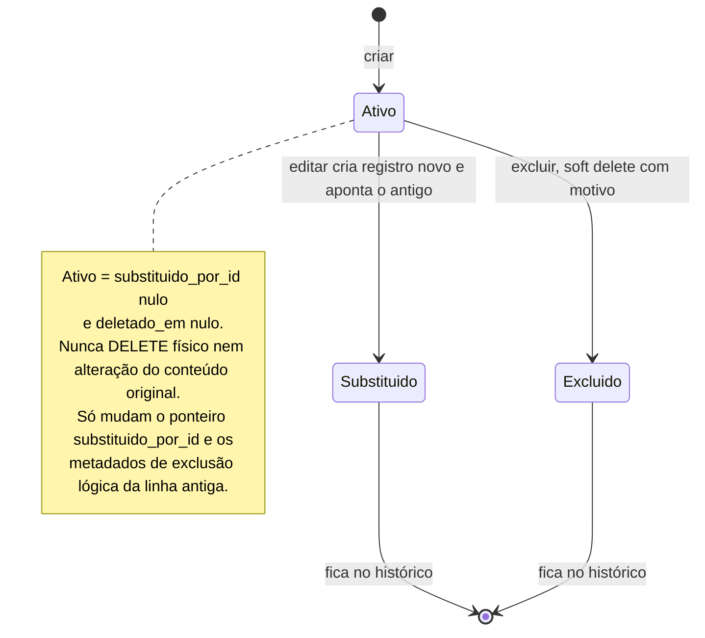

Tipos de documento: nota fiscal, ordem de serviço, TRP, TRD, CNEN SCRA e CNEN licença. Validade só vale na licença.

Inauguração: previsão, realizada e "dispensada" são excludentes, no máximo um evento ativo no conjunto (409 se repetir). Entrega por item não passa mais pelo seletor de marcos da linha do tempo.

### 7.1 Ações (tarefas livres)

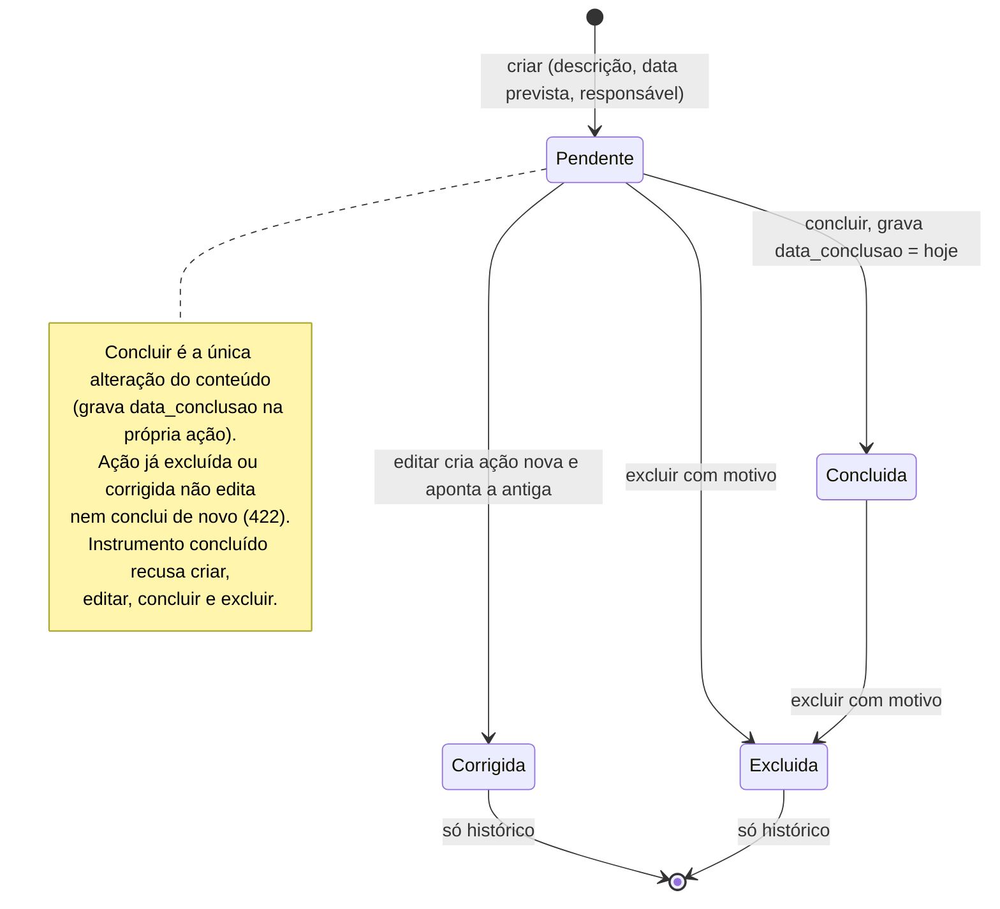

Corrigir uma ação já concluída preserva a data de conclusão na versão corrigida. No detalhe, os contadores de abertas e atrasadas vêm do instrumento inteiro (não só do lote de até 200 linhas), as pendentes vêm antes das concluídas e o filtro "Só pendentes" é aplicado no servidor.

Ação não tem tipo nem catálogo: é texto livre com vencimento. Quem edita segue a titularidade do instrumento (seção 8). O responsável da ação (`responsavel_id`) é quem executa; quem criou fica em `criado_por_id`, sempre vindo da sessão. A lista do detalhe vem de `GET /monitoramento/instrumentos/{nr}/acoes` (até 200 e o total).

### 7.2 Eventos: manuais, gerados por entrega e gerados pela conclusão

| Origem | Como nasce | Edita ou exclui na linha do tempo? |
|---|---|---|
| Manual | Usuário lança marco do catálogo | Sim (editar corrige append-only; excluir é soft delete com motivo) |
| `cronograma_entrega` | Gerado ao registrar entrega de equipamento | Não: 409 "vem de uma entrega". A data muda por `PATCH /monitoramento/entregas/{id}/data` (com motivo) e entrega e evento mudam juntos |
| Inauguração dispensada ou prevista | Gravada na entrega (a pergunta "precisa de inauguração?") | Segue a regra de inauguração (um só ativo no conjunto, 409 se repetir) |
| Inauguração realizada | Gerada ao concluir, se a data foi informada | Idem; ao concluir só pode nascer a realizada, nunca a dispensada |

Instrumento concluído recusa qualquer escrita de evento até ser reaberto. A tela lista apenas eventos ativos (corrigidos e excluídos ficam no histórico do banco).

## 8. Quem pode fazer o quê

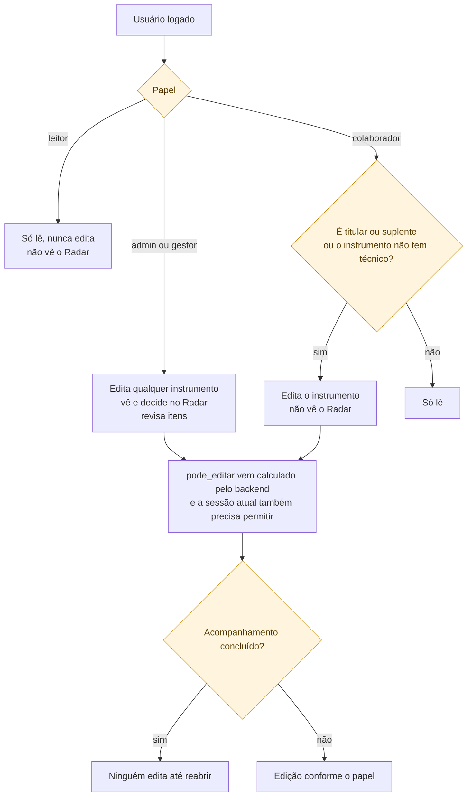

Radar de instrumentos, fila de revisão de itens e aprovação: só gestor e admin. O backend recusa leitura do Radar (lista, histórico, prova) com 403 para os demais papéis, e o botão some do cabeçalho.

## 9. Radar de instrumentos (revisão 2)

O Radar lista convênios novos do SICONV que ainda não estão na carteira. Só gestor e admin acessam.

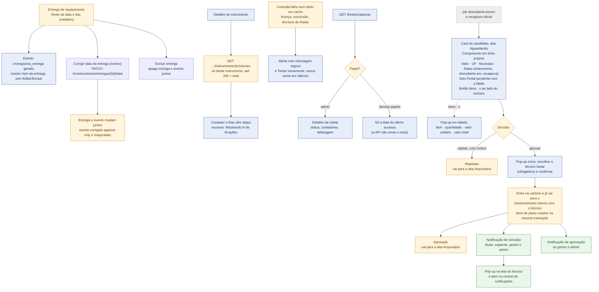

Busca, paginação e bloqueios do Radar:

- A lista aceita `busca` (até 100 caracteres), `situacao` (novo, em análise, aprovado, rejeitado; várias), `confirmacao` do portal (não consultado, não encontrado, sem publicação, confirmado) e paginação de 1 a 50 por página (padrão 10). Só entram descobertas da fonte oficial.
- Só gestor e admin ativos listam, veem histórico e prova, decidem e aprovam; os demais recebem 403.
- Rejeitar exige a versão atual do candidato (409 "o candidato mudou" se alguém decidiu antes) e uma situação que permita a decisão.
- Aprovar exige a prova da última recaptura: hash conferido e rodada completa, com a publicação do SICONV (rodada parcial ou sem publicação dá 409). A chave de aprovação é idempotente: repetir com os mesmos dados devolve o mesmo resultado; com dados diferentes (inclusive outro técnico titular, comparado com o titular gravado na decisão original, `candidato_legado_decisao.tecnico_titular_id`), 409.
- Concorrência: a aprovação trava o lote e o candidato; se a carteira ou o histórico conflitarem, 409 e nada é gravado.

Detalhes do aprovar com técnico:

- O botão **Aprovar** fica desabilitado, com o motivo no tooltip, enquanto não houver recaptura gravada (o Portal é opcional desde 23/11; a validade de 24 h da prova foi removida); com ela, abre o mesmo pop-up de "Adicionar ao monitoramento interno": o técnico titular é obrigatório e **Confirmar** já leva o instrumento ao monitoramento. Não há mais "Iniciar análise"; sobra Aprovar e Rejeitar.
- A lista tem duas abas: **Aguardando** (novo e em análise) e **Arquivados** (aprovado e rejeitado). O card não mostra o campo Item; o botão **Itens · n**, ao lado do número do convênio, abre um pop-up em tabela (item, quantidade, valor unitário e total) com todos os bens da última recaptura.
- O monitor da coleta (status, defasagem, contagens e detalhes) aparece completo só para o admin. Os demais perfis veem apenas a data e hora da última coleta com sucesso.
- O técnico titular é obrigatório também na API (sem ele, 422): toda aprovação vai ao monitoramento. A mesma transação cria o instrumento monitorado (tipo Convênio, origem `radar_aprovacao`), grava o titular e emite o aviso de inclusão. Se qualquer passo falhar, nada é gravado.
- O pop-up aparece na tela do técnico indicado, no próximo ciclo do sino (até 60 segundos), uma vez por aviso, com atalho para o instrumento. Quem apenas incluiu não recebe o pop-up, só o aviso no sino.
- O resumo oficial (valor, município e UF) vem da última recaptura. Sem recaptura, a lista mostra traço em vez de inventar valor.

## 10. Avisos e jobs

### 10.1 Origem dos avisos

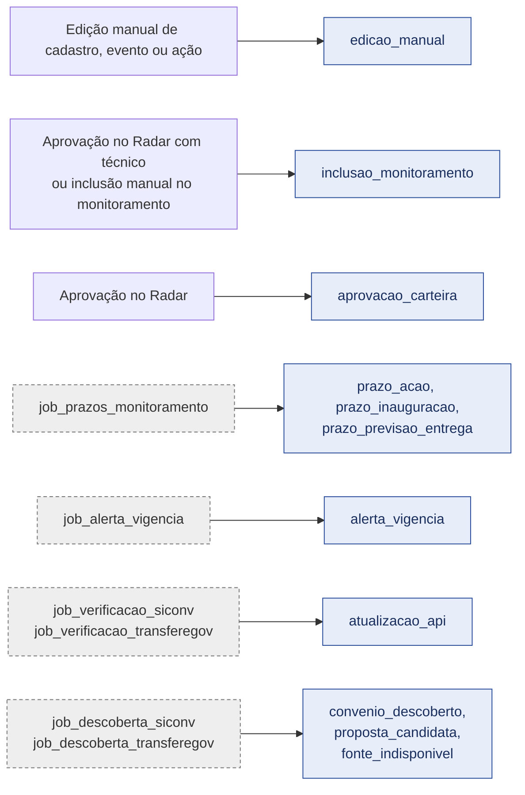

### 10.2 Quem recebe cada aviso

| Aviso | Destinatários |
|---|---|
| `edicao_manual`, `atualizacao_api`, `prazo_*`, `inclusao_monitoramento` | Titular, suplente, gestor e admin ativos; sem técnico, só gestor e admin. Exceção: rodada do SICONV com mais de 10 instrumentos alterados manda individual só a titular e suplente e um resumo à gestão (mapa do Radar, seção 15) |
| `alerta_vigencia` | Igual ao anterior quando há instrumento monitorado; sem instrumento, só gestor e admin |
| `aprovacao_carteira`, `convenio_descoberto`, `fonte_indisponivel` | Só gestor e admin |
| `proposta_candidata` | Todos, exceto leitor (broadcast) |

Leitor nunca recebe aviso. Colaborador que não é titular nem suplente não recebe aviso de instrumento alheio.

### 10.3 Jobs, agenda e efeito

| Job | O que faz | Agenda | Estado | Grava |
|---|---|---|---|---|
| `job_prazos_monitoramento` | Avisa D-1, D0 e D+1 de ação aberta com prazo, de previsão de inauguração não realizada e de previsão de entrega de item controlado cuja unidade ainda está pendente (`prazo_previsao_entrega`). Dedup por `chave_dedup`; concluir, excluir ou reagendar arquiva os avisos antigos | 08:00 de São Paulo (intenção) | **Não agendado.** Só roda à mão, com simulação por padrão e `--aplicar --confirmo-host` | `Notificacao` |
| `job_alerta_vigencia` | Convênios com fim de vigência em até 90 dias. Não repete o mesmo convênio em 30 dias | Diário no `radar_convenios.yml` (06:30 Brasília) | Só roda se a variável `ATUALIZACOES_RADAR_ATIVAS` for `true`; manual pelo `workflow_dispatch` | `Notificacao` |
| `job_verificacao_siconv` | Baixa o dump oficial do SICONV e reconcilia convênios conhecidos e instrumentos. Compara por chave estável; a primeira captura de cada convênio vira linha de base | Diário (mesmo workflow) | Mesma variável | `Convenio`, `InstrumentoEquipamento`, `Notificacao` |
| `job_verificacao_transferegov` | Consulta ao vivo cada parceria monitorada (parceria e ordens de pagamento) | Diário (mesmo workflow) | Mesma variável | Instrumento, repasse, `Notificacao` |
| `job_descoberta_transferegov` | Descobre propostas do TransfereGov de programas do Ministério da Saúde | Diário (mesmo workflow) | Mesma variável | Propostas candidatas, `Notificacao` |
| `job_descoberta_siconv` | Coleta fresca de convênios para o Radar; nunca inclui na carteira nem no monitoramento | Diário (mesmo workflow) | Mesma variável | Candidatos do Radar |
| `job_recaptura_legado` (passo `recaptura` do `radar_convenios.yml`) | Grava valor, município, UF e itens do plano de cada candidato aberto, com publicação no SICONV e sem recaptura da descoberta atual; o Portal é opcional | Diário, depois da descoberta SICONV; também manual (`tarefa=recaptura`) | Mesma variável | Recaptura do candidato |
| `job_revalidacao_legado_local` | Revalidação de escopo histórico sobre snapshot local | Manual | Só em clone local validado | Candidatos do Radar |
| `pipelines.yml` | Atualiza cobertura (tomógrafo, ressonância, PET-CT) e população | 06:00 Brasília | Só com `ATUALIZACOES_PIPELINES_ATIVAS=true`; fora do monitoramento interno | Dados de cobertura |
| `backup_banco.yml` | `pg_dump` cifrado com `age` para o R2, retenção de 7 dias | 02:17 e 14:17 UTC | Ligado | R2 |

Regras comuns: simulação por padrão nos scripts que gravam; `--aplicar` exige `--confirmo-host`; o aviso é criado por `criar_notificacao`, que grava o destinatário na criação (não em tempo de leitura); aviso de instrumento ou convênio fora de escopo não aparece para ninguém, com uma exceção: o resumo da rodada do SICONV (`siconv-resumo:`) não some quando o instrumento usado como âncora sai do escopo.

Importante para o release: os workflows definem o cron no código, mas cada rotina só roda quando a variável do GitHub (`ATUALIZACOES_*_ATIVAS`) está `true`. O valor dessas variáveis no GitHub não foi consultado nesta revisão, então o mapa não afirma se algum agendamento está efetivamente ligado. O backup (`backup_banco.yml`) tem agendamento próprio, sem essa variável. A decisão de ligar cada rotina fica para depois de uma rodada supervisionada.

### 10.4 Rotas que os diagramas não detalham

| Rota | Quem | O que faz |
|---|---|---|
| `GET /monitoramento/classificacao/fila` | gestor, admin | Itens pendentes de revisão (sem convênio fora de escopo) |
| `POST /monitoramento/classificacao/itens/{item_id}` | gestor, admin | Confirmar, corrigir ou marcar "não é equipamento" (seção 4.3) |
| `GET /monitoramento/acoes` | qualquer logado | Ações da carteira inteira, teto 500; o detalhe usa `.../instrumentos/{nr}/acoes` |
| `GET /relatorios/encerrados` e `/relatorios/entregues` | qualquer logado | Prévias dos relatórios Concluídos e Entregues |

## 11. Registro de funcionalidades (para a equipe marcar)

Marque a coluna final com **usa**, **não usa** ou **não conheço**.

| # | Funcionalidade | Onde fica | Equipe usa? |
|---|---|---|---|
| 1 | Filtros da Mesa: busca por número, convenente, CNES ou município; contratação; CNES; UF; município; prioritário; equipamento; situação; programa; período; **responsável** (técnico titular, com a opção "Sem responsável") | Mesa de trabalho | |
| 2 | Indicadores no topo da Mesa e lista de instrumentos | Mesa de trabalho | |
| 3 | Adicionar instrumento ao monitoramento | Dados oficiais | |
| 4 | Cadastro interno (técnico titular e suplente, nível, tipologia, modalidade, responsável da execução, CNES) | Detalhe | |
| 5 | Editar o CNES (dentro de Editar cadastro, junto com os demais campos) | Detalhe, Cadastro interno | |
| 6 | Registrar entrega com várias unidades por item | Detalhe, Equipamentos | |
| 7 | Corrigir unidade (marca, modelo, série, vida útil) | Detalhe, Equipamentos | |
| 8 | Excluir entrega com motivo | Detalhe, Equipamentos | |
| 9 | Cancelar e desfazer cancelamento de unidade | Detalhe, Equipamentos | |
| 10 | Previsão de entrega por item (definir e remover) | Detalhe, Equipamentos | |
| 11 | Confirmar repasse integral ou parcial | Detalhe, Equipamentos | |
| 12 | Vincular entrega antiga (legado): removido; registrar a entrega pelo fluxo normal | Detalhe, Equipamentos | |
| 13 | Card de licença de operação (somente leitura) | Detalhe | |
| 14 | Documentos (6 tipos), incluindo corrigir e excluir | Detalhe, Cronograma | |
| 15 | Lançar evento de cronograma e regulatório | Detalhe, Cronograma | |
| 16 | Editar e excluir evento, com motivo | Detalhe, Eventos | |
| 17 | Ações: criar, editar, concluir, excluir, com prazo e responsável | Detalhe, Ações | |
| 18 | Concluir e reabrir acompanhamento | Detalhe, Fase | |
| 19 | Fila de revisão de itens (confirmar, corrigir, não é equipamento) | Revisão de itens | |
| 20 | Notificações por edição, prazo e vigência, com pop-up de instrumento novo | Sino | |
| 21 | Relatórios de instrumentos e repasse (Excel e Word) | Relatórios | |
| 22 | Radar: ver candidatos, rejeitar e aprovar com técnico (vai direto ao monitoramento) | Radar (gestor e admin) | |

## 12. Código sem uso

Método: busca por nome em todo o `frontend/src` e `backend` (incluindo testes). Candidato não é prova de código morto, mas todos os itens abaixo tinham **zero chamadas** fora da própria definição e foram removidos na revisão 2, depois de rodar lint, tipos e a suíte inteira.

### Removidos

| Item | Onde |
|---|---|
| `codigos_familias_com_licenca` | `repositories/documentos.py` (sobra da licença por item) |
| `listar_marcos_fase_geral_desc` | `repositories/monitoramento.py` (fase agora é calculada) |
| `preencher_ano_convenio_se_ausente` | `repositories/monitoramento.py` |
| `repositories/auditoria_marcadores.py` e seu teste | só um teste importava |
| `AjudaCampo` | `monitoramento-ui.tsx` |
| `useEntregasLegadas`, `fetchEntregasLegadas`, `vincularEntregaLegada`, hook de vínculo, `GET /monitoramento/entregas-legadas`, `POST .../vincular`, `vincular_entregas_legadas` e a situação "A vincular" | função de vincular entrega antiga removida (21/11/2026) |
| `TECNICOS_EQUIPE` | `lib/monitoramento-opcoes.ts` (o cadastro usa `GET /monitoramento/colaboradores`) |
| `LEGENDA_STATUS` | `lib/monitoramento-status.ts` |
| `getMapThemeColors` | `lib/theme-colors.ts` |
| `equipamentosDaProposta` | `lib/proposta-metas-resumo.ts` |
| Tipos `ProgramaTransfereGov`, `ConvenioPortal`, `ComponentePropostaApi`, `ComponenteOncologia` | `types/monitoramento.ts` |
| `mapa_eventos_por_instrumento` | `repositories/monitoramento.py` (fase é calculada; só um comentário de script citava) |
| `obter_por_rodada` | `repositories/recapturas_legado.py` (só um teste usava) |
| `situacao-fontes.tsx` e seu teste | componente sem importador; a tela usa o resumo por papel |
| `ROTULOS_CONFIRMACAO`, `ROTULOS_RELACAO` | `lib/legado-rotulos.ts` |
| `CandidatoLegadoProvaResumo` e a conferência com checkbox e justificativa | Radar, substituídos pela aprovação com técnico |

### Mantidos, para a equipe decidir

| Item | Motivo |
|---|---|
| Rota `/monitoramento-equipamentos/entradas` | Só redireciona; mantida por links antigos |
| Exports só usados em testes (`mediaReferenciaFase`, `formatarNup`, `codificarSituacao`) | Têm teste próprio; remover só se a funcionalidade sair |
| Exports usados só no próprio arquivo (`motivoExclusaoSchema`, `unidadeEntregaSchema`, `itemEntregaSchema`, `conclusaoKeys`, `documentosKeys`) | Só o `export` está sobrando |
| `EtapaExpandida`, `PropostaExpandida` | Ainda referenciados por outros tipos do mesmo arquivo |
| Scripts de uma só execução | Arquivar depois do release (lista abaixo) |

### Scripts de uma só execução (arquivar depois do release)

`migrar_marcos_para_documentos`, `migrar_concluidos_para_conclusao`, `migrar_eventos_inauguracao_prevista`, `remover_persus_ii_do_monitoramento`, `corrigir_entregas_persus_i`, `concluir_persus_i_pela_inauguracao`, `consolidar_eventos_marco_duplicados`, `derivar_repasses_siconv`, `projetar_itens_plano` (este também serve de rotina recorrente), `preencher_*`, `importar_planilha_monitoramento`, `importar_programas_monitoramento`. Depois do release e da conferência em produção, mover para `scripts/arquivo/` ou remover, mantendo o histórico no git.

O POST de eventos ainda aceita registrar `fase_concluido` (com data e confirmação de inauguração) e esse caminho **não passa pela avaliação de impedimentos** da conclusão estruturada (`POST .../conclusao`); o evento ativo passa a contar como concluído. Pendente já registrado no plano do fluxo: remover a leitura do evento antigo `fase_concluido` em `fatos_do_instrumento` e `fases_calculadas_em_lote` depois de conferir a produção.

## 13. Limites desta análise

- Busca textual, não análise de grafo de chamadas: função chamada por nome dinâmico ou por reflexão não seria detectada. Por isso a remoção foi validada por lint, tipos e testes.
- Endpoints foram cruzados com o frontend pelo caminho; endpoint usado só por script externo apareceria como "com consumidor" se o texto coincidir.
- Uso real em produção não foi medido. Para isso, olhar `AuditLog` por tipo de ação (quem lançou o quê, quando) é o melhor indicador de funcionalidade que a equipe não usa.
- A agenda dos jobs reflete os arquivos de workflow. O valor das variáveis `ATUALIZACOES_*_ATIVAS` no GitHub não foi consultado.

## 14. Painel de gestão e Meu painel (24/11/2026)

Os indicadores e gráficos das duas telas são só leitura e usam as mesmas regras de situação do equipamento. A única escrita é o botão **Incluir no monitoramento** da Carteira do Meu painel (mesma mutação do botão de "Dados oficiais").

- **Painel de gestão** (carteira inteira): filtros mínimos na URL (`useSearchParams`, compartilháveis) e quatro filtros locais dos gráficos (família, inauguração, atualização, prazo) em estado da página; os demais cliques dos gráficos escrevem na URL. Ano inválido na URL é ignorado. O catálogo de marcos não é consultado.
- **Meu painel** (carteira do técnico logado): filtros em estado local da página, recorte pela região do técnico; `gestor` e `admin` escolhem o colaborador.

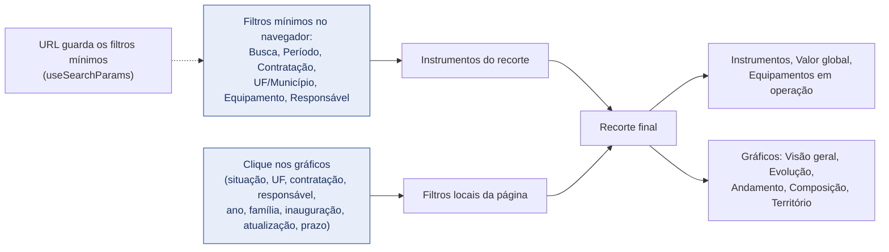

### 14.1 Situação do equipamento

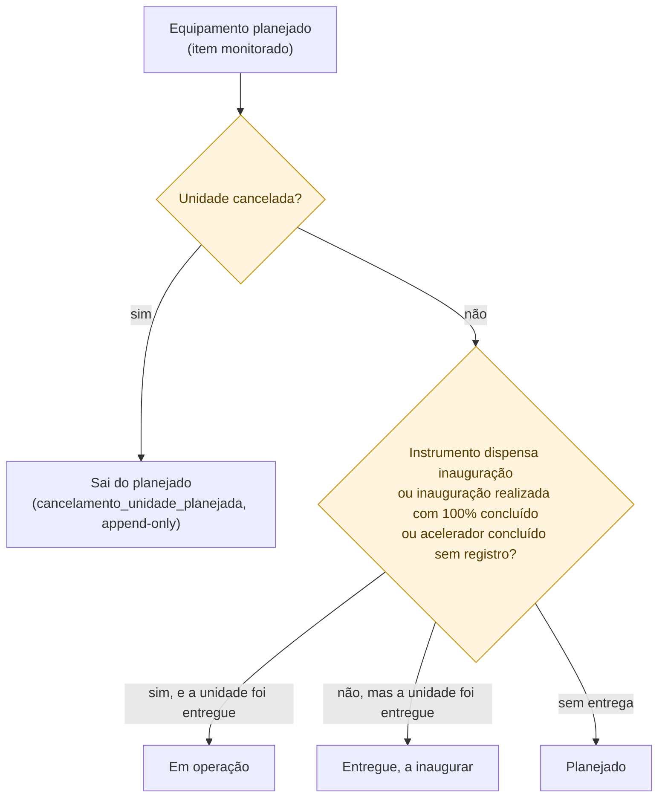

A regra vive só no Painel de gestão e no Meu painel (`lib/painel-gestao-operacao.ts`, `lib/painel-gestao-andamento.ts`); relatórios e demais telas não a usam. A conclusão do instrumento é decisão do técnico: o painel não conclui nada sozinho, de modo que equipamento entregue em instrumento ainda aberto fica "a inaugurar".

### 14.2 Valor global

`valor_global` só entra na soma quando é numérico **e** a fonte é confiável (`financeiro.fonteConfiavel`) ou o desembolso é integral da carga (`desembolso_integral_da_carga`: FAF, TED, PERSUS I, PERSUS II, PRONON). Instrumento sem valor aparece como "—" em "Investimento por contratação" ("n de m com valor"). Preencher valor ausente é carga de dado (scripts `definir_valor_persus_ii.py` e `registrar_convenio_faf_parceria.py`, simulação por padrão, `--aplicar --confirmo-host`), nunca edição do painel.

### 14.3 Cancelamento de unidade planejada

`cancelar_unidade_planejada` (`services/cancelamento_unidade.py`) grava em `cancelamento_unidade_planejada`, append-only, com motivo. Só vale em instrumento não concluído (`assert_nao_concluido`). O cancelamento reduz o planejado do item e não vira "entrega".

### 14.4 Registro de funcionalidades (painel)

| Funcionalidade | Onde |
| --- | --- |
| Filtros mínimos no navegador de seções | `painel-gestao-filtros*.tsx` |
| Chips de recortes ativos e "Limpar" | `painel-gestao-recortes.tsx` |
| Seções Visão geral, Evolução, Andamento, Composição | `painel-gestao-secao-*.tsx` |
| Derivação dos gráficos (pura, testável) | `lib/painel-gestao-derivados.ts` |
| Completude do cadastro (só admin) | `painel-gestao-completude.tsx` |
| Mapa por município | `monitoramento-painel-geografia.tsx` |
| Incluir na carteira (única escrita do Meu painel) | `painel-tecnico-carteira.tsx` |
