# Mapa do Radar de instrumentos (revisão 3, de 22/11/2026)

Objetivo: servir de base para a equipe validar o fluxo do Radar e apontar funcionalidade ou código sem uso. Tudo aqui foi lido do código da branch `feat/persus-ii-fora-do-monitoramento` (estado de 22/11/2026) e conferido, em leitura, contra o banco de produção de 21/11/2026. A revisão 2 incorpora os blocos 1 a 3 do plano [planmode-radar-confirmacao-e-ruido-2026-11-22.md](../planos/planmode-radar-confirmacao-e-ruido-2026-11-22.md), que estão em commits locais e **ainda não estão em produção**. Os diagramas usam Mermaid e renderizam no Obsidian, no GitHub e no VS Code.

Escopo: o Radar de convênios do SICONV (candidatos "legados"), da descoberta diária até a entrada na carteira de monitoramento. Cobre também a aba de propostas do TransfereGov e o job que a alimenta, porque dividem o workflow e a central. O detalhe do que acontece depois da aprovação está em [monitoramento-interno.md](monitoramento-interno.md).

Itens que não deu para confirmar só pelo código vão marcados com `> [!warning] A confirmar`.

## 1. Visão de ponta a ponta

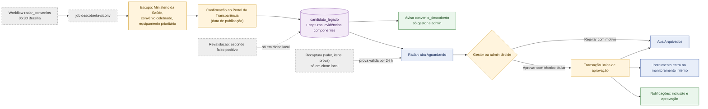

O fluxo tem duas metades que não se falam por rede: a coleta (job e recaptura, escrevem no banco) e a triagem humana (API e telas, só leem e decidem). O que liga as duas é o banco e a regra de frescor da prova.

## 2. Acesso e telas

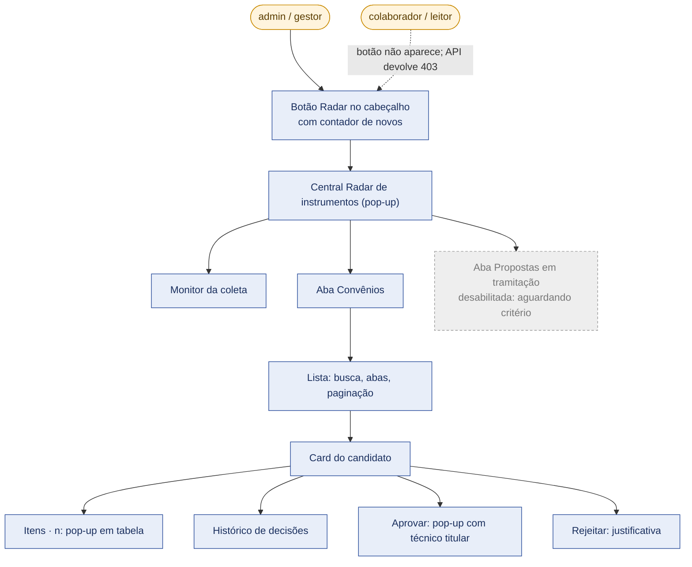

O contador de novos no botão é a quantidade de candidatos oficiais sem decisão (`contar_novos`), recalculada a cada 60 segundos. A aba "Propostas em tramitação" existe no código e carrega a lista de propostas do TransfereGov sob demanda, mas fica desabilitada na tela com a dica "Aguardando definição do critério de propostas novas".

O monitor da coleta mostra status, defasagem e contagens só para o `admin`. Os demais perfis veem apenas a data e hora da última coleta com sucesso (`/fontes/capturas` corta na API, não só na tela). Uma fonte aparece como defasada quando passa de 36 horas sem captura bem-sucedida.

## 3. Descoberta SICONV (job diário)

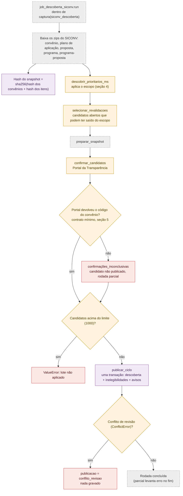

Desde o bloco 3, a falha de contrato de um candidato não adia mais as revalidações dos demais: a revalidação usa só o SICONV e não depende do Portal.

Modo da rodada: sem baseline anterior da fonte, o orquestrador (`atualizar_dados_producao`) liga `baseline_silenciosa`, e a primeira carga grava os candidatos sem avisar ninguém. Rodadas seguintes são `incremental` e notificam.

## 4. Critério de escopo (o que vira candidato)

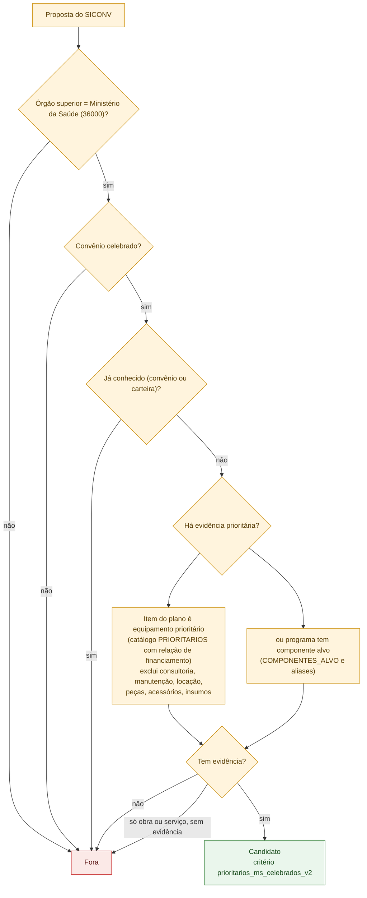

Duplicidade com dados divergentes na fonte levanta `ValueError` e a rodada não publica. O catálogo de equipamentos prioritários é o mesmo das 16 famílias do monitoramento por item.

## 5. Confirmação no Portal da Transparência

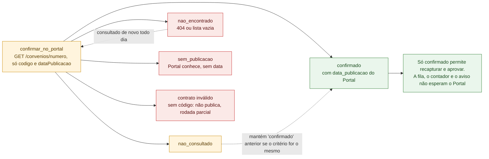

**Contrato por finalidade (22/11/2026).** Confirmar só consome `dimConvenio.codigo` e `dataPublicacao`, então o contrato de confirmação (`DimConvenioConfirmacao`) exige só o código. Um registro do Portal com `numero` e `objeto` vazios, como o do convênio `7AAFSX`, passa a confirmar a publicação. O contrato completo (`DimConvenioPortal`, dentro de `PortalLegadoCapturado`) continua exigido onde o dado entra de fato: na recaptura e na aprovação, com convenente, município e data.

**Comportamento observado do Portal (produção, 21/11/2026).** Os 12 candidatos hoje confirmados começaram como `nao_encontrado` e viraram `confirmado` no mesmo dia, 18/11. A data de publicação do Portal sempre coincide com a do SICONV; o Portal só demora a expor o registro.

| Convênio | Publicado no SICONV | Confirmado no Portal | Espera |
| --- | --- | --- | --- |
| `998681` | 27/10 | 18/11 | 22 dias |
| `7AACXC` | 04/11 | 18/11 | 14 dias |
| `7AACXB`, `7AAFQV` | 05/11 | 18/11 | 13 dias |
| `7AAEPR` | 06/11 | 18/11 | 12 dias |
| Seis convênios | 12 e 13/11 | 18/11 | 5 a 6 dias |

Como a checagem é diária, cada espera tem margem de 1 dia. Fora do padrão: `7AAFRI` (SICONV em 23/09, ausente do Portal há 59 dias) e `7AAFSX` (registro vazio desde 05/11, tratado acima). A causa do lote de 18/11 é externa: não houve commit na descoberta entre 27/10 e 21/11, e o dump do SICONV é atualizado todo dia (Last-Modified de 21/11, 11:12).

A data do instrumento exibida no card é a data de assinatura do SICONV; se faltar, vale a data de publicação do Portal.

## 6. Persistência e avisos

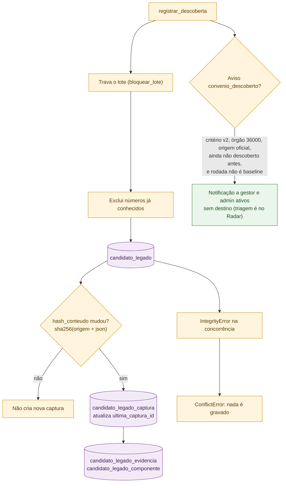

Evidência anterior só é mesclada quando o candidato ainda não tem critério. Tabelas de apoio: `candidato_legado_decisao` (seção 8), `candidato_legado_recaptura` (seção 7) e `FonteCaptura` (uma linha por rodada, com fonte `siconv_descoberta`, `siconv_recaptura` ou `siconv_revalidacao`).

## 7. Recaptura, prova e revalidação

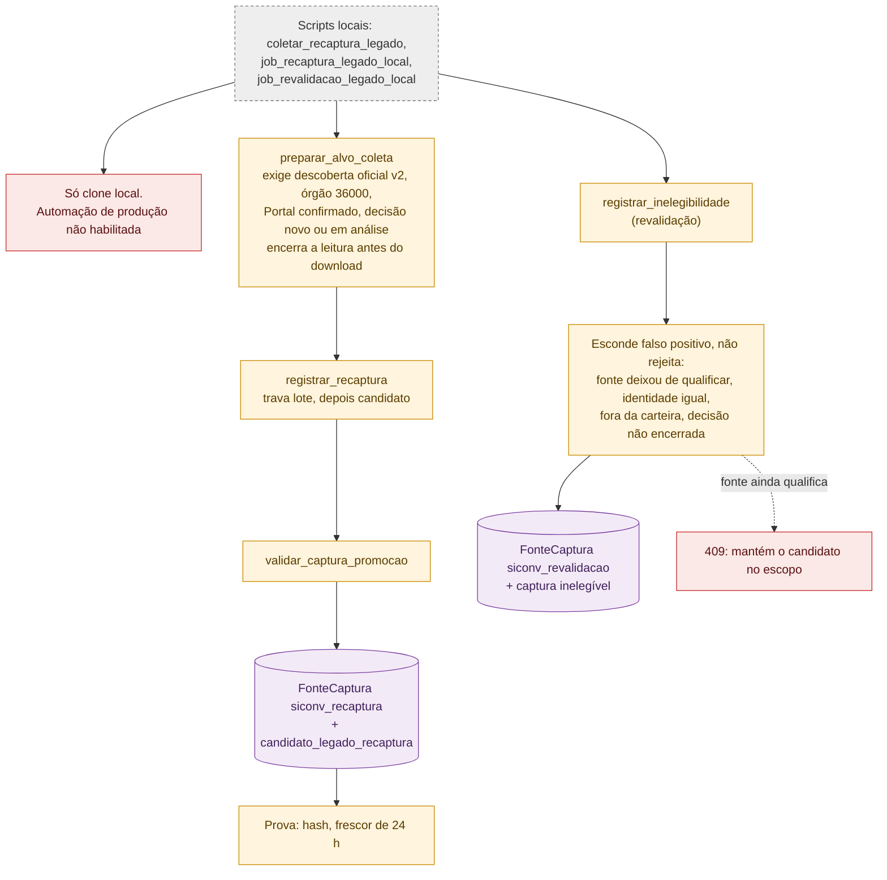

A validação da prova (`validar_captura_promocao`) confere: hash igual, mesmo candidato, convênio celebrado no escopo, Ministério da Saúde, confirmação do Portal inalterada, datas oficiais inalteradas, obra ou serviço não aceito como aquisição de equipamento e evidência prioritária inalterada.

`VALIDADE_RECAPTURA` é de 24 horas. Replay da mesma recaptura é reconhecido pelo horário de início.

**Conferido em produção (21/11/2026): a recaptura nunca rodou.** `candidato_legado_recaptura` tem 0 linhas e não existe nenhuma rodada `siconv_recaptura`. Como a aprovação exige uma recaptura de até 24 horas, nenhum candidato chegou à carteira pelo Radar: `convenio` e `instrumento_equipamento` não têm registro com origem `radar_aprovacao`. Há 11 candidatos confirmados sem decisão, o mais antigo descoberto em 28/10, e 1 rejeitado. Os 427 instrumentos e 560 convênios atuais vêm de cargas manuais.

> [!warning] A confirmar
> Decidir como a recaptura passa a existir em produção (agendada com a chave do Portal, ou operada à mão com procedimento documentado). Isso grava em produção e mexe em operação, então depende de autorização.

## 8. Estados do candidato e decisões

```mermaid
stateDiagram-v2
    [*] --> novo: descoberto (Portal pode estar pendente)
    novo --> em_analise: iniciar_analise (API; sem botão na tela)
    novo --> rejeitado: rejeitar com justificativa
    em_analise --> rejeitado: rejeitar com justificativa
    novo --> aprovado: aprovar (transação da seção 9)
    em_analise --> aprovado: aprovar (transação da seção 9)
    rejeitado --> [*]
    aprovado --> [*]
```

Regras das decisões (`candidato_legado_decisao`): a tabela é imutável por trigger (`trg_decisao_legado_imutavel`), com `situacao` em em_analise, rejeitado ou aprovado, justificativa de 3 a 1000 caracteres, chave única por candidato e uma decisão de aprovação por convênio. O campo `versao` do candidato é o id da última decisão: decidir com versão velha dá 409 "O candidato mudou". Repetir a mesma chave devolve o resultado anterior (idempotência).

Quem decide: só `admin` e `gestor` ativos. A listagem mostra na aba Aguardando os estados novo e em análise, e na aba Arquivados aprovado e rejeitado.

## 9. Aprovação (transação única)

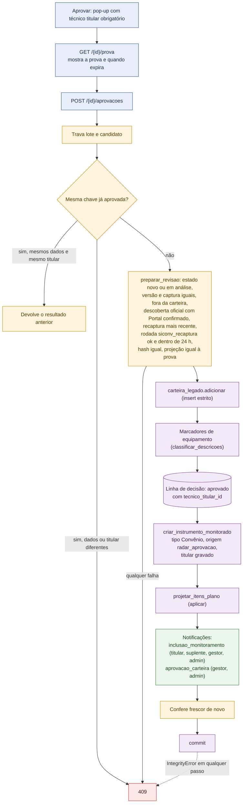

Sem `tecnico_titular_id` a API responde 422 (a validação do Zod no front deixa o campo opcional de propósito; quem garante é o backend). Se qualquer passo falhar, nada é gravado.

Depois do commit, o front invalida as consultas do Radar, do histórico, da prova, da lista de convênios, do monitoramento e das notificações, e mostra "Convênio aprovado e incluído no monitoramento.". O técnico indicado recebe um pop-up na próxima atualização do sino (até 60 segundos), uma vez por aviso, guardado no armazenamento do navegador por usuário (janela de 7 dias). Quem só aprovou recebe apenas o item no sino.

## 10. Lista, filtros e paginação

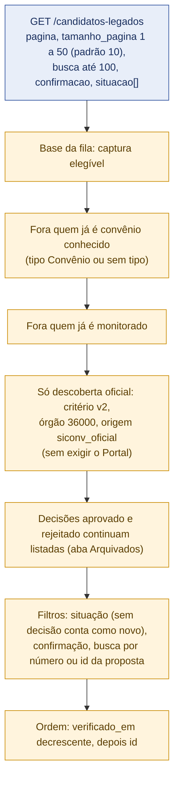

Valor global, município, UF e itens do card vêm da última recaptura; sem recaptura, a lista mostra traço (ou os nomes da evidência, no caso dos itens) em vez de inventar.

## 11. Propostas do TransfereGov (job e aba)

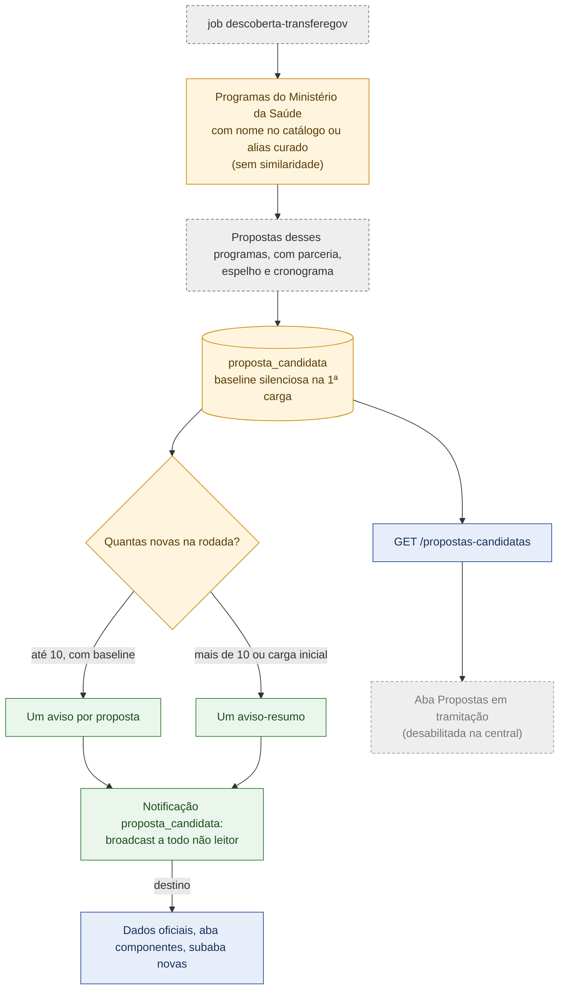

As duas frentes são independentes: o Radar de convênios (SICONV, legado) tem triagem humana e entra na carteira; as propostas do TransfereGov só são listadas e avisadas, sem fluxo de aprovação. A chave de deduplicação é `id_proposta` do TransfereGov, nunca comparada com número de convênio do SICONV (universos disjuntos).

## 12. Workflow, cron e proteções

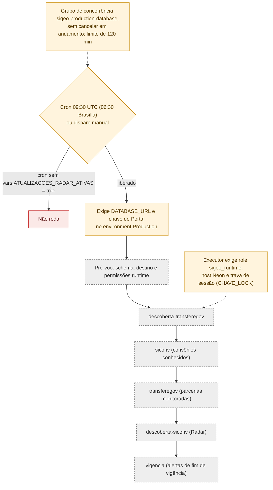

Cada tarefa roda só se o pré-voo passou e não foi cancelada; no disparo manual dá para escolher uma tarefa só. Uma tarefa que falha não impede as seguintes (usam `!cancelled()`).

Conferido em 21/11/2026: a variável `ATUALIZACOES_RADAR_ATIVAS` está `true`, então o Radar roda sozinho em produção todo dia às 06:30 de Brasília (o CLAUDE.md antigo dizia o contrário e foi corrigido).

Estado observado em produção: a tarefa `descoberta-siconv` termina como parcial todos os dias desde 27/10 (24 rodadas). A causa era o registro vazio do `7AAFSX` no Portal, recusado pelo contrato rígido. O bloco 3 corrige isso (commit `4412c81`), mas só vale depois do release. Até lá a rodada continua vermelha, sem corromper dado.

## 13. API

| Rota | Quem | O que faz |
| --- | --- | --- |
| `GET /candidatos-legados` | gestor, admin | Lista paginada (seção 10) |
| `GET /candidatos-legados/{id}/prova` | gestor, admin | Resumo da prova da última recaptura e validade (sempre só leitura) |
| `POST /candidatos-legados/{id}/aprovacoes` | gestor, admin | Aprovação com técnico titular (seção 9) |
| `POST /candidatos-legados/{id}/decisoes` | gestor, admin | `iniciar_analise` ou `rejeitar` |
| `GET /candidatos-legados/{id}/historico` | gestor, admin | Decisões em ordem, paginadas |
| `GET /notificacoes` | qualquer logado não leitor | Lista do usuário, com `destino` calculado, busca, tipo, caixa e paginação |
| `PATCH /notificacoes/{id}` | destinatário | Marca como lida |
| `PATCH /notificacoes/lidas` | destinatário | Marca todas como lidas |
| `PATCH /notificacoes/{id}/arquivo` | destinatário | Arquiva ou restaura |
| `GET /fontes/capturas` | qualquer logado | Detalhe para admin, só data do último sucesso para os demais |
| `GET /propostas-candidatas` | qualquer logado | Lista do TransfereGov |

Toda rota mutável exige o cabeçalho CSRF (`X-CSRF-Token`). As sequências de chamadas estão na seção 17.

## 14. Segurança, trava e concorrência

- Ordem de trava: lote, depois candidato (decisões, recaptura e aprovação seguem a mesma ordem), para evitar impasse.
- Decisão e aprovação conferem `versao` e `captura_id` do candidato: se mudou desde que a tela carregou, 409.
- Idempotência por chave (UUID gerado no front) em decisão e aprovação; recaptura por horário de início.
- Decisões são imutáveis por trigger no banco; corrigir é decidir de novo, nunca editar.
- Prova só vale por 24 horas e só se o hash bater com a captura. A consulta da prova nunca grava.
- Revalidação esconde, nunca rejeita: quem some do escopo some da fila, mas a decisão humana continua soberana.

## 15. Avisos do espelho SICONV e popup de detalhe

O job `siconv` (convênios já conhecidos) compara o dump novo com o último dado e avisa mudança real em instrumento monitorado.

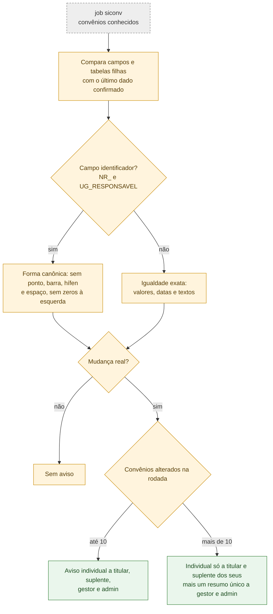

Motivo da forma canônica: a fonte alternava `000.969` e `969` (e `02` e `002`), e cada alternância virava aviso, entre 80 e 110 por dia. `969` e `970` continuam diferentes. Instrumento sem titular nem suplente não recebe aviso individual na rodada grande; a gestão o vê no resumo. O resumo usa `chave_dedup` com prefixo `siconv-resumo:` e não tem destino, porque não pertence a um instrumento só. O leitor nunca recebe.

O texto do aviso agora vem em linhas: campos do convênio, depois um bloco por tabela filha com os registros alterados e até 5 registros novos detalhados.

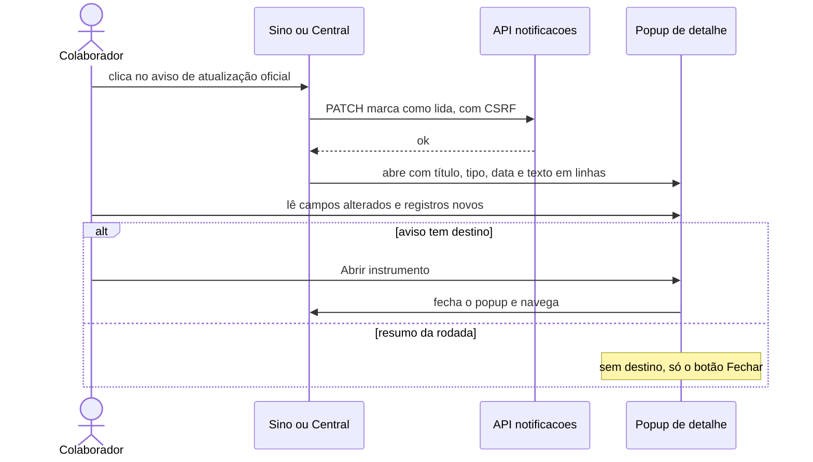

Só `atualizacao_api` com texto abre o popup; os demais tipos seguem indo direto ao registro. Aviso antigo, gravado numa linha só, é quebrado por campo no popup.

## 16. Fontes externas e suas APIs

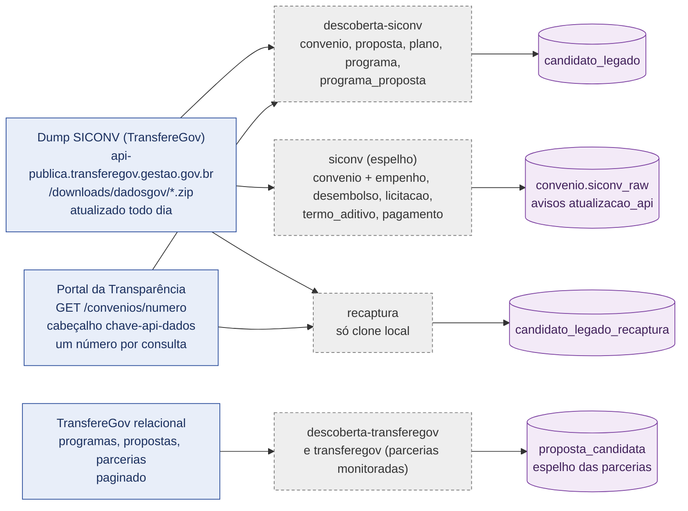

Limites conhecidos das fontes: o Portal responde 404 ou lista vazia para convênio ainda não publicado nele (`nao_encontrado`) e pode devolver registro com campos vazios (`7AAFSX`); o SICONV não é o gargalo, porque o dump é diário. O catálogo oficial atual é o do Comunicado TransfereGov 23/2026; não há fallback ao repositório descontinuado, porque HTTP 200 não prova frescor.

## 17. Fluxos de API (sequências)

**Triagem e aprovação.**

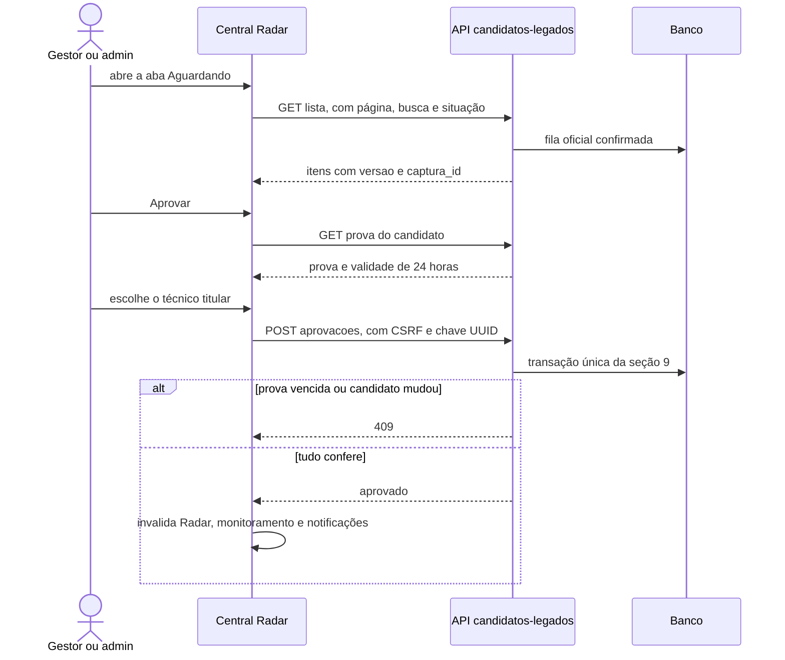

**Rejeição e histórico.**

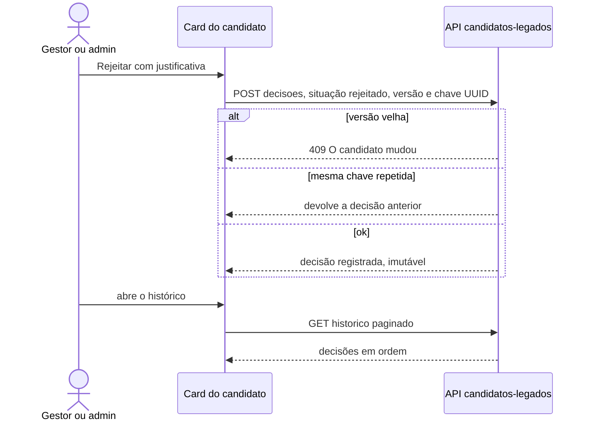

**Monitor da coleta e alerta de fonte.**

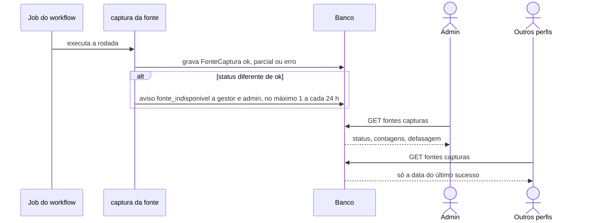

O corpo do aviso `fonte_indisponivel` é substituído por texto genérico na fronteira pública, porque capturas antigas podem ter guardado exceção crua.

**Notificações.**

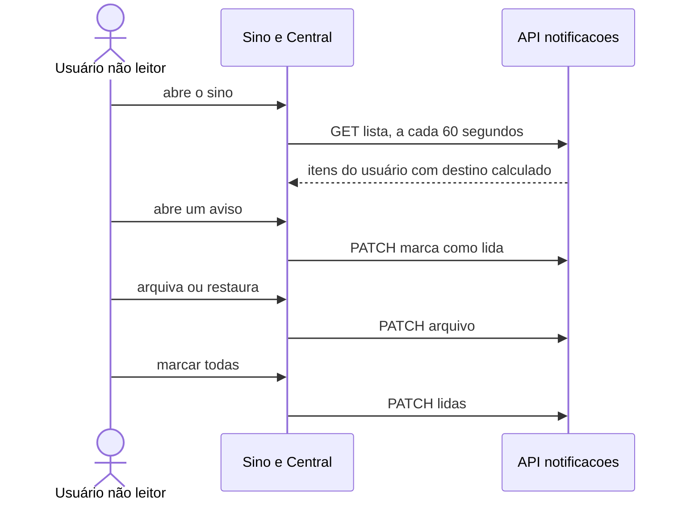

## 18. Radar antes do Portal (implementado em 22/11/2026)

O Portal é necessário para **recapturar e aprovar**, porque a recaptura traz convenente, município e data do Portal, e esses campos são gravados uma vez na aprovação. Para **enxergar** o candidato ele só atrasava, porque o SICONV já traz assinatura e publicação e o Portal repete a mesma data. Por isso a confirmação deixou de esconder o candidato e continua travando a aprovação.

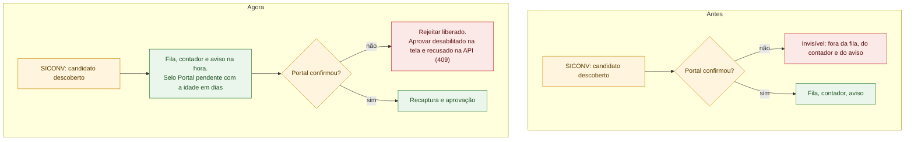

O que mudou no código:

- A fila e o contador deixaram de exigir `confirmacao_portal = 'confirmado'`. O modo diagnóstico (listagem sem `somente_oficiais`) foi removido em 22/11/2026: a lista é sempre só a descoberta oficial.
- O aviso `convenio_descoberto` sai na primeira descoberta oficial, sem esperar o Portal, e uma vez só: a confirmação posterior não repete (`numeros_ja_descobertos_oficialmente`). Os candidatos que já existiam em produção não geram aviso retroativo.
- O card mostra o selo "Portal pendente · há N dias" (contado da descoberta) enquanto a análise está aberta.
- O botão Aprovar aparece desabilitado até o Portal confirmar. A API também recusa: `preparar_revisao` devolve 409 com "Aprovar exige a confirmação do convênio no Portal da Transparência", mesmo que alguém chame a rota direto.
- A recaptura continua exigindo a confirmação (`preparar_alvo_coleta`).

Por que não aprovar antes do Portal: o cadastro nasceria sem convenente, CNPJ, município, UF, região e ano, que alimentam filtros, mapa, relatórios e o cruzamento com o CNES. O espelho diário só atualiza campos do SICONV e nada preencheria esses buracos depois. A aba "Aguardando Portal" do plano deixou de ser necessária, porque o selo e a idade ficam na própria fila.

> [!warning] A confirmar
> A aprovação segue travada enquanto a recaptura não rodar em produção (seção 7).

### Revisão 3: três estados, não um

"Portal confirmou" e "pode aprovar" são coisas diferentes. O candidato passa por três estados independentes:

| Estado | Quem decide | Onde aparece |
| --- | --- | --- |
| Publicação confirmada | Rodada da descoberta (Portal) | Selo "Portal pendente" some |
| Prova vigente | Recaptura de até 24 h (`VALIDADE_RECAPTURA`) | Campo "Recaptura" no card; sem prova, Aprovar fica desabilitado com o motivo ("Prova ausente" ou "Prova vencida") |
| Aprovado | Decisão humana, transação única | Situação "Aprovado" |

- O card separa "Descoberto em" (primeira vez no SICONV) de "Recaptura" (última prova oficial, `recaptura_em`). A tela só antecipa o bloqueio: quem decide é a API, que devolve 409 se a prova faltar ou estiver vencida, antes do POST.
- Contrato do Portal inconclusivo (campo vazio, timeout): a confirmação usa só `codigo` e `dataPublicacao`, então um registro esqueleto não derruba a rodada nem adia revalidações. O estado `inconclusivo` do plano não foi implementado.
- A revalidação do job diário usa o snapshot do SICONV. O script `job_revalidacao_legado_local` é separado e roda só em clone local.
- Rejeitar trava o candidato (situação terminal).
- A medição de 5 a 22 dias entre SICONV e Portal vem da amostra de 12 confirmados em produção (inclui `7AAIPN`, de 13/11 para 18/11); não é garantia.
- Seção 15: a comparação canônica vale para os campos identificadores; a chave do registro (`NR_MOV_FIN`) segue em texto cru (produção: 0 casos de pontuação ou zero à esquerda em 1.664 chaves). O limite de 10 conta instrumentos monitorados com aviso elegível. O resumo da rodada (`siconv-resumo:`) não some quando o instrumento usado como âncora sai do escopo.
- Implementado nos commits 948d642 (documentação) e 5c5641e (código) e nos desta revisão.

## 19. Registro de funcionalidades (para a equipe marcar)

| Funcionalidade | Estado no código | Equipe confirma |
| --- | --- | --- |
| Descoberta diária SICONV com escopo do Ministério da Saúde | Ativa no workflow, condicionada à variável | |
| Confirmação no Portal da Transparência | Ativa | |
| Baseline silenciosa na primeira carga | Ativa | |
| Aviso `convenio_descoberto` a gestor e admin | Ativa | |
| Botão Radar e contador de novos (gestor, admin) | Ativa | |
| Busca, abas Aguardando e Arquivados, paginação | Ativa | |
| Card com valor, UF, município, datas e Itens · n | Ativa | |
| Rejeitar com justificativa e histórico | Ativa | |
| Iniciar análise | API existe; sem botão na tela | |
| Aprovar com técnico titular, entrada no monitoramento | Ativa | |
| Pop-up de inclusão para o técnico | Ativa | |
| Monitor da coleta por papel | Ativa | |
| Recaptura (valor, itens, prova) | Só em clone local | |
| Revalidação (esconde falso positivo) | Só em clone local | |
| Aba Propostas em tramitação | Código pronto, desabilitada na tela | |
| Comparação canônica de identificadores do SICONV | Implementada em 22/11, só em commit local | |
| Popup de detalhe da atualização oficial (sino e Central) | Implementado em 22/11, só em commit local | |
| Resumo único para a gestão acima de 10 convênios | Implementado em 22/11, só em commit local | |
| Confirmação do Portal só com código e data | Implementada em 22/11, só em commit local | |
| Fila, contador e aviso sem esperar o Portal; selo Portal pendente; Aprovar travado até confirmar (seção 18) | Implementado em 22/11, só em commit local | |
| Aba Aguardando Portal | Dispensada: o selo e a idade ficam na própria fila | |
| Job de descoberta TransfereGov e avisos de proposta | Ativo no workflow | |

## 20. Código sem uso

- Removidos em 22/11/2026: `descobrir_legado` (só os testes o chamavam), o script `diagnosticar_descoberta_siconv.py` (diagnóstico sobre snapshot local, sem referência em workflow ou documentação), o modo diagnóstico da lista e a origem `snapshot_local` do contrato da API. O CHECK do banco ainda admite `snapshot_local` e as guardas de linha legada nos serviços ficam até uma migration estreitar o CHECK (produção tem só `siconv_oficial`: 31 capturas).
- Ação `iniciar_analise` e estado `em_analise`: a API aceita, a tela não tem mais o botão. O estado ainda aparece na aba Aguardando. Decidir se vira código a remover ou se volta para a tela.
- Aba "Propostas em tramitação": carrega a lista sob demanda, mas fica desabilitada. Hoje a aba não é alcançável pelo usuário.
- `Notificacao.lida` está obsoleta; o escopo por destinatário vale (`NotificacaoDestinatario`).

## 21. Limites desta análise

- Não executei o job contra o SICONV ou o Portal; o mapa vem da leitura do código e dos testes.
- A ausência de recaptura em produção vem de contagem no banco em 21/11/2026 (0 linhas); não sei se alguém a roda fora do banco de produção.
- A causa do lote de 9 candidatos descobertos em 17/11 não foi determinada (não é código nem frescor do dump); faltam os dumps daqueles dias.
- A espera do Portal é medida com checagem diária, com margem de 1 dia.
- Os componentes `candidato-legado-aprovacao.tsx`, `candidato-legado-historico.tsx`, `candidato-legado-item.tsx` e `candidato-legado-itens-dialog.tsx` foram descritos a partir dos hooks, do serviço e do mapa do monitoramento, sem releitura linha a linha nesta revisão.
- O comportamento de rede (tempos, limites do Portal) não está no código e não entra aqui.
