# Mapa do Radar de instrumentos (revisão 1, de 21/11/2026)

Objetivo: servir de base para a equipe validar o fluxo do Radar e apontar funcionalidade ou código sem uso. Tudo aqui foi lido do código da branch `feat/persus-ii-fora-do-monitoramento` (estado de 21/11/2026). Os diagramas usam Mermaid e renderizam no Obsidian, no GitHub e no VS Code.

Escopo: o Radar de convênios do SICONV (candidatos "legados"), da descoberta diária até a entrada na carteira de monitoramento. Cobre também a aba de propostas do TransfereGov e o job que a alimenta, porque dividem o workflow e a central. O detalhe do que acontece depois da aprovação está em [monitoramento-interno.md](monitoramento-interno.md).

Itens que não deu para confirmar só pelo código vão marcados com `> [!warning] A confirmar`.

## 1. Visão de ponta a ponta

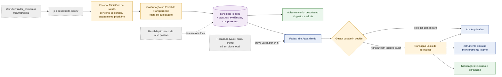

O fluxo tem duas metades que não se falam por rede: a coleta (job e recaptura, escrevem no banco) e a triagem humana (API e telas, só leem e decidem). O que liga as duas é o banco e a regra de frescor da prova.

## 2. Acesso e telas

O contador de novos no botão é a quantidade de candidatos oficiais sem decisão (`contar_novos`), recalculada a cada 60 segundos. A aba "Propostas em tramitação" existe no código e carrega a lista de propostas do TransfereGov sob demanda, mas fica desabilitada na tela com a dica "Aguardando definição do critério de propostas novas".

O monitor da coleta mostra status, defasagem e contagens só para o `admin`. Os demais perfis veem apenas a data e hora da última coleta com sucesso (`/fontes/capturas` corta na API, não só na tela). Uma fonte aparece como defasada quando passa de 36 horas sem captura bem-sucedida.

## 3. Descoberta SICONV (job diário)

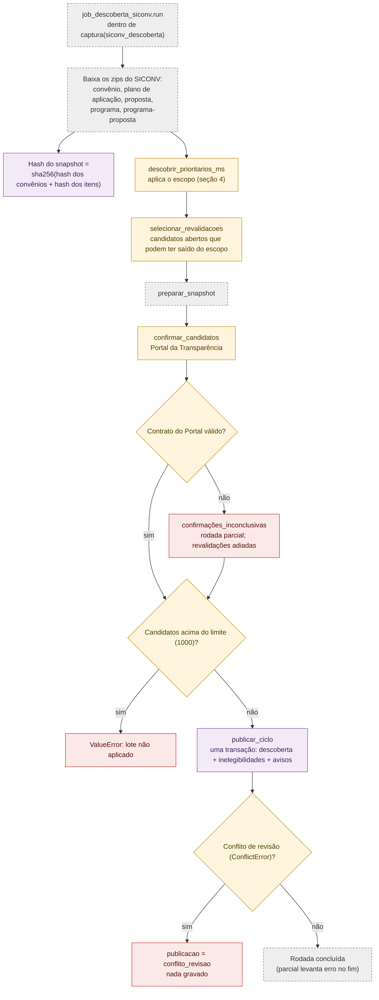

Modo da rodada: sem baseline anterior da fonte, o orquestrador (`atualizar_dados_producao`) liga `baseline_silenciosa`, e a primeira carga grava os candidatos sem avisar ninguém. Rodadas seguintes são `incremental` e notificam.

## 4. Critério de escopo (o que vira candidato)

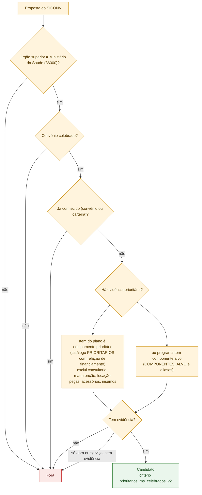

Duplicidade com dados divergentes na fonte levanta `ValueError` e a rodada não publica. O catálogo de equipamentos prioritários é o mesmo das 16 famílias do monitoramento por item.

## 5. Confirmação no Portal da Transparência

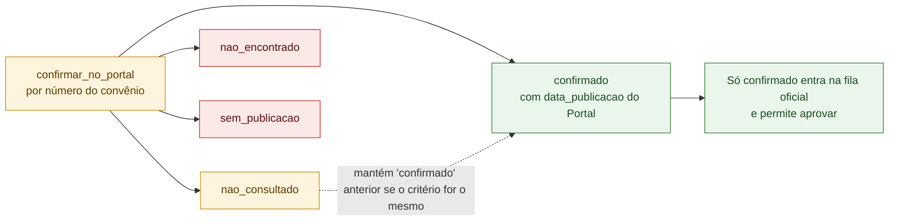

A data do instrumento exibida no card é a data de assinatura do SICONV; se faltar, vale a data de publicação do Portal.

## 6. Persistência e avisos

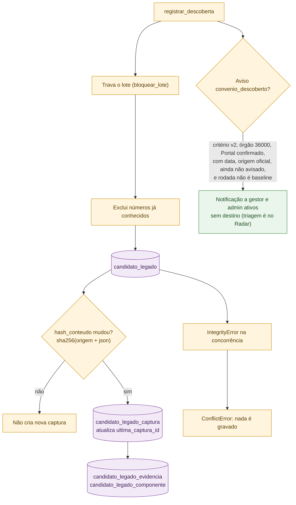

Evidência anterior só é mesclada quando o candidato ainda não tem critério. Tabelas de apoio: `candidato_legado_decisao` (seção 8), `candidato_legado_recaptura` (seção 7) e `FonteCaptura` (uma linha por rodada, com fonte `siconv_descoberta`, `siconv_recaptura` ou `siconv_revalidacao`).

## 7. Recaptura, prova e revalidação

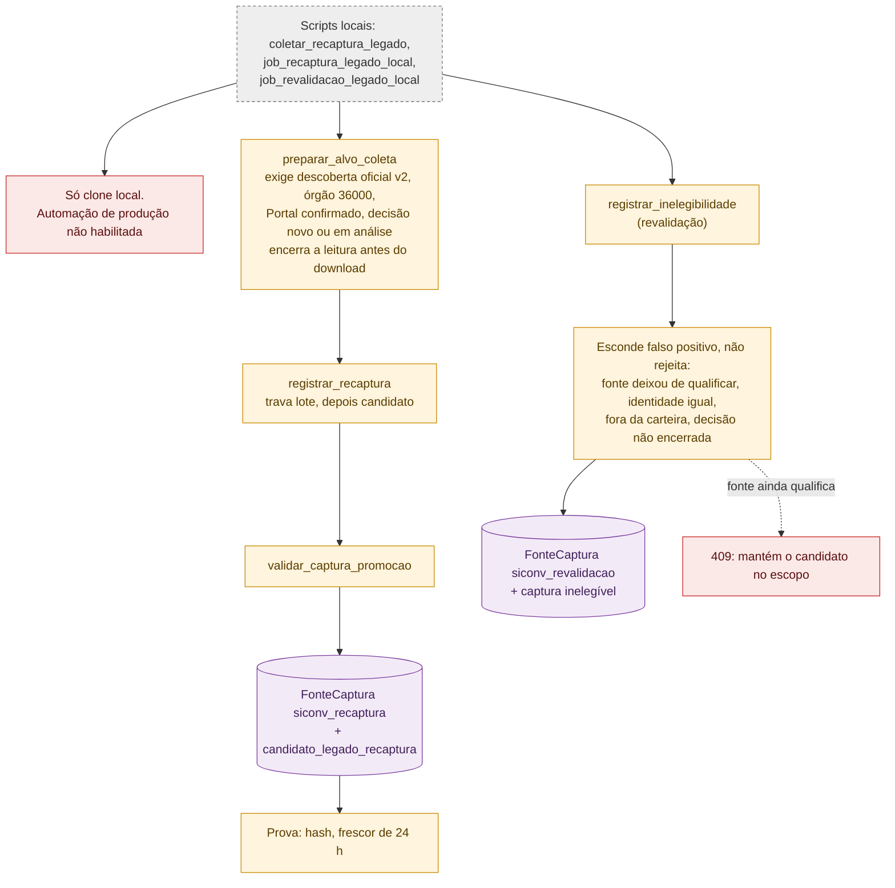

A validação da prova (`validar_captura_promocao`) confere: hash igual, mesmo candidato, convênio celebrado no escopo, Ministério da Saúde, confirmação do Portal inalterada, datas oficiais inalteradas, obra ou serviço não aceito como aquisição de equipamento e evidência prioritária inalterada.

`VALIDADE_RECAPTURA` é de 24 horas. Replay da mesma recaptura é reconhecido pelo horário de início.

> [!warning] A confirmar
> Os scripts de recaptura e revalidação declaram em docstring que rodam só em clone local e que a automação de produção não está habilitada. Se a recaptura não roda em produção, a aprovação em produção depende de alguém rodá-la à mão antes, porque sem prova de até 24 h a aprovação é recusada. Confirmar com a equipe como isso é operado hoje.

## 8. Estados do candidato e decisões

```mermaid
stateDiagram-v2
    [*] --> novo: descoberto e confirmado
    novo --> em_analise: iniciar_analise (API; sem botão na tela)
    novo --> rejeitado: rejeitar com justificativa
    em_analise --> rejeitado: rejeitar com justificativa
    novo --> aprovado: aprovar (transação da seção 9)
    em_analise --> aprovado: aprovar (transação da seção 9)
    rejeitado --> [*]
    aprovado --> [*]
```

Regras das decisões (`candidato_legado_decisao`): a tabela é imutável por trigger (`trg_decisao_legado_imutavel`), com `situacao` em em_analise, rejeitado ou aprovado, justificativa de 3 a 1000 caracteres, chave única por candidato e uma decisão de aprovação por convênio. O campo `versao` do candidato é o id da última decisão: decidir com versão velha dá 409 "O candidato mudou". Repetir a mesma chave devolve o resultado anterior (idempotência).

Quem decide: só `admin` e `gestor` ativos. A listagem mostra na aba Aguardando os estados novo e em análise, e na aba Arquivados aprovado e rejeitado.

## 9. Aprovação (transação única)

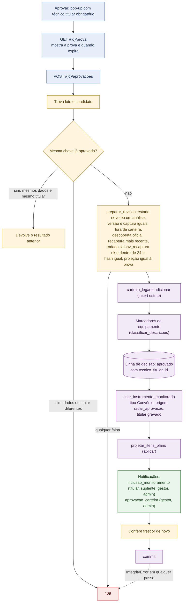

Sem `tecnico_titular_id` a API responde 422 (a validação do Zod no front deixa o campo opcional de propósito; quem garante é o backend). Se qualquer passo falhar, nada é gravado.

Depois do commit, o front invalida as consultas do Radar, do histórico, da prova, da lista de convênios, do monitoramento e das notificações, e mostra "Convênio aprovado e incluído no monitoramento.". O técnico indicado recebe um pop-up na próxima atualização do sino (até 60 segundos), uma vez por aviso, guardado no armazenamento do navegador por usuário (janela de 7 dias). Quem só aprovou recebe apenas o item no sino.

## 10. Lista, filtros e paginação

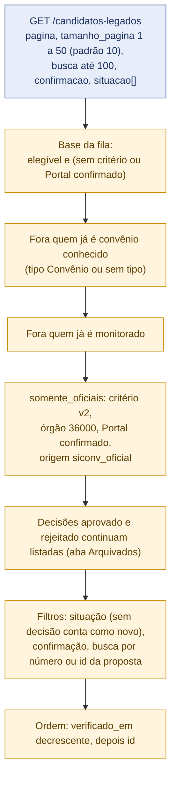

Valor global, município, UF e itens do card vêm da última recaptura; sem recaptura, a lista mostra traço (ou os nomes da evidência, no caso dos itens) em vez de inventar.

## 11. Propostas do TransfereGov (job e aba)

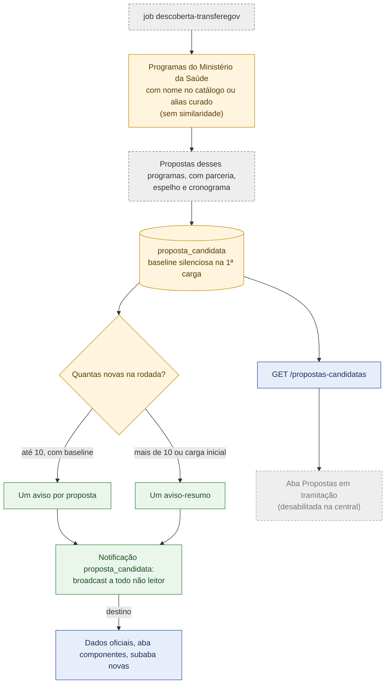

As duas frentes são independentes: o Radar de convênios (SICONV, legado) tem triagem humana e entra na carteira; as propostas do TransfereGov só são listadas e avisadas, sem fluxo de aprovação. A chave de deduplicação é `id_proposta` do TransfereGov, nunca comparada com número de convênio do SICONV (universos disjuntos).

## 12. Workflow, cron e proteções

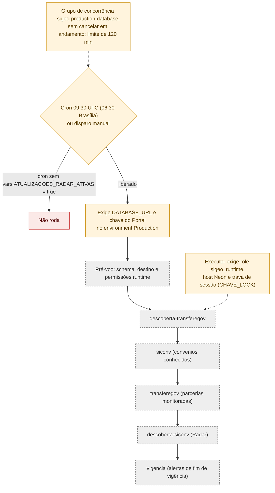

Cada tarefa roda só se o pré-voo passou e não foi cancelada; no disparo manual dá para escolher uma tarefa só. Uma tarefa que falha não impede as seguintes (usam `!cancelled()`).

Conferido em 21/11/2026: a variável `ATUALIZACOES_RADAR_ATIVAS` está `true`, então o Radar roda sozinho em produção todo dia às 06:30 de Brasília (o CLAUDE.md antigo dizia o contrário e foi corrigido).

Estado observado nas rodadas de 19 a 21/11: a tarefa `descoberta-siconv` termina como parcial todos os dias, porque o Portal da Transparência devolve para o convênio `7AAFSX` um registro com número e objeto vazios (contrato inválido). Oito candidatos ficam sem confirmação e as revalidações são adiadas. Nenhum dado é corrompido, mas a rodada conta como falha.

## 13. API

| Rota | Quem | O que faz |
| --- | --- | --- |
| `GET /candidatos-legados` | gestor, admin | Lista paginada (seção 10) |
| `GET /candidatos-legados/{id}/prova` | gestor, admin | Resumo da prova da última recaptura e validade (sempre só leitura) |
| `POST /candidatos-legados/{id}/aprovacoes` | gestor, admin | Aprovação com técnico titular (seção 9) |
| `POST /candidatos-legados/{id}/decisoes` | gestor, admin | `iniciar_analise` ou `rejeitar` |
| `GET /candidatos-legados/{id}/historico` | gestor, admin | Decisões em ordem, paginadas |
| `GET /fontes/capturas` | qualquer logado | Detalhe para admin, só data do último sucesso para os demais |
| `GET /propostas-candidatas` | qualquer logado | Lista do TransfereGov |

Toda rota mutável exige o cabeçalho CSRF (`X-CSRF-Token`).

## 14. Segurança, trava e concorrência

- Ordem de trava: lote, depois candidato (decisões, recaptura e aprovação seguem a mesma ordem), para evitar impasse.
- Decisão e aprovação conferem `versao` e `captura_id` do candidato: se mudou desde que a tela carregou, 409.
- Idempotência por chave (UUID gerado no front) em decisão e aprovação; recaptura por horário de início.
- Decisões são imutáveis por trigger no banco; corrigir é decidir de novo, nunca editar.
- Prova só vale por 24 horas e só se o hash bater com a captura. A consulta da prova nunca grava.
- Revalidação esconde, nunca rejeita: quem some do escopo some da fila, mas a decisão humana continua soberana.

## 15. Registro de funcionalidades (para a equipe marcar)

| Funcionalidade | Estado no código | Equipe confirma |
| --- | --- | --- |
| Descoberta diária SICONV com escopo do Ministério da Saúde | Ativa no workflow, condicionada à variável | |
| Confirmação no Portal da Transparência | Ativa | |
| Baseline silenciosa na primeira carga | Ativa | |
| Aviso `convenio_descoberto` a gestor e admin | Ativa | |
| Botão Radar e contador de novos (gestor, admin) | Ativa | |
| Busca, abas Aguardando e Arquivados, paginação | Ativa | |
| Card com valor, UF, município, datas e Itens · n | Ativa | |
| Rejeitar com justificativa e histórico | Ativa | |
| Iniciar análise | API existe; sem botão na tela | |
| Aprovar com técnico titular, entrada no monitoramento | Ativa | |
| Pop-up de inclusão para o técnico | Ativa | |
| Monitor da coleta por papel | Ativa | |
| Recaptura (valor, itens, prova) | Só em clone local | |
| Revalidação (esconde falso positivo) | Só em clone local | |
| Aba Propostas em tramitação | Código pronto, desabilitada na tela | |
| Job de descoberta TransfereGov e avisos de proposta | Ativo no workflow | |

## 16. Código sem uso

- `descobrir_legado` em `backend/app/services/descoberta_legado.py`: só os testes o chamam (`tests/test_descoberta_legado.py`). O fluxo de produção usa `descobrir_prioritarios_ms`. Candidato a remoção junto com o teste; `confirmar_no_portal` do mesmo arquivo continua em uso.
- Ação `iniciar_analise` e estado `em_analise`: a API aceita, a tela não tem mais o botão. O estado ainda aparece na aba Aguardando. Decidir se vira código a remover ou se volta para a tela.
- Aba "Propostas em tramitação": carrega a lista sob demanda, mas fica desabilitada. Hoje a aba não é alcançável pelo usuário.
- `Notificacao.lida` está obsoleta; o escopo por destinatário vale (`NotificacaoDestinatario`).

## 17. Limites desta análise

- Não executei o job contra o SICONV ou o Portal; o mapa vem da leitura do código e dos testes.
- Não verifiquei se a recaptura é rodada em produção por alguém (ver aviso na seção 7).
- Os componentes `candidato-legado-aprovacao.tsx`, `candidato-legado-historico.tsx`, `candidato-legado-item.tsx` e `candidato-legado-itens-dialog.tsx` foram descritos a partir dos hooks, do serviço e do mapa do monitoramento, sem releitura linha a linha nesta revisão.
- O comportamento de rede (tempos, limites do Portal) não está no código e não entra aqui.
