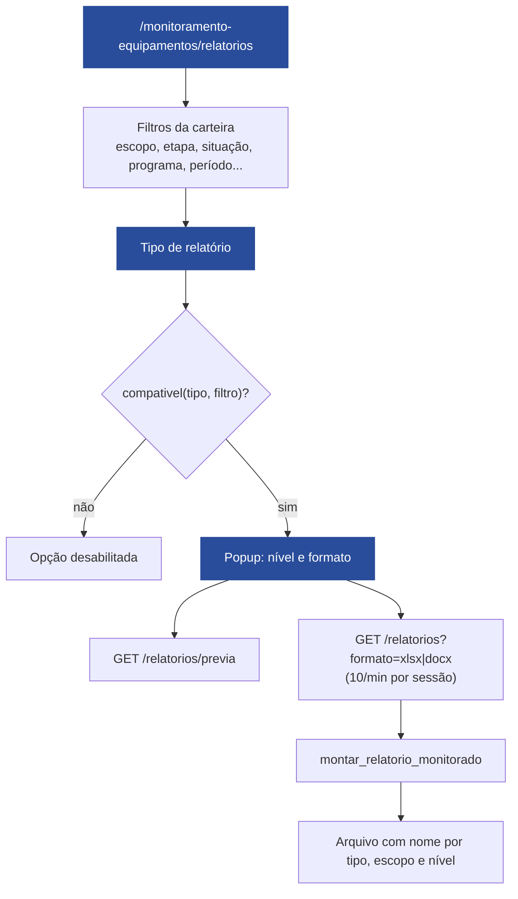
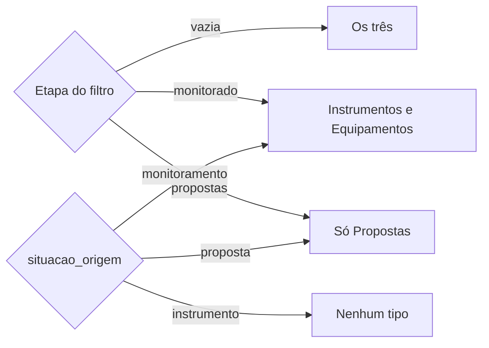
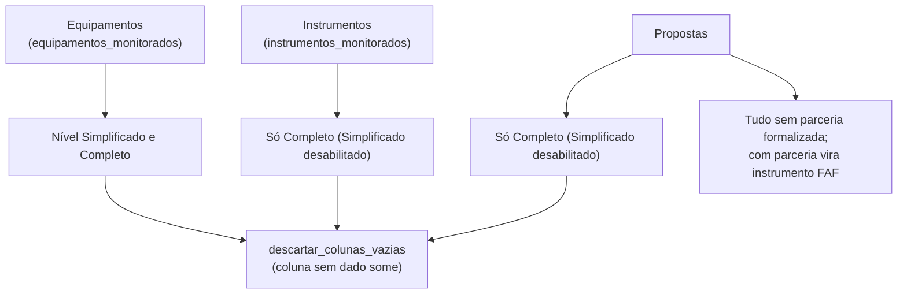
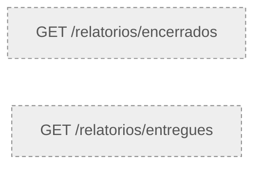

# Mapa dos relatórios do monitoramento (revisão 1, de 27/11/2026)

## Objetivo e escopo

Página `/monitoramento-equipamentos/relatorios`: carteira filtrada, prévia e download em Excel ou Word de três tipos (Equipamentos, Instrumentos, Propostas). Lido de `routers/relatorios.py`, `relatorio-carteira.tsx`, `relatorio-exportacao-carteira.tsx` e `services/relatorios_*`. Relatório de mérito está em [analise-de-merito.md](analise-de-merito.md).

## 1. Da tela ao arquivo

## 2. Regra de compatibilidade tipo × etapa

## 3. O que cada tipo traz

Equipamento usa o nome canônico do catálogo (ex.: "Mamógrafo"). Instrumento é exibido por `exibir_instrumento`, processo por `formatar_processo`, CNPJ por `formatar_cnpj`.

## 4. Rotas antigas

## Registro de funcionalidades

| Funcionalidade | Onde | Estado |
| --- | --- | --- |
| Prévia | `/relatorios/previa` | ativo |
| Download xlsx/docx | `/relatorios` | ativo, 10/min por sessão |
| Equipamentos, Instrumentos, Propostas | `TipoRelatorio` | ativo |
| `instrumentos_repasse`, `analise_merito` | `TipoRelatorio` | ativo no backend; mérito tem tela própria |

## Código sem uso

> [!warning] A confirmar
> `/relatorios/encerrados` e `/relatorios/entregues` (com `relatorios_encerrados.py` e `relatorios_entregues.py`) não foram vistos sendo chamados pelo frontend. Confirmar antes de remover.

## Limites desta análise

> [!warning] A confirmar
> Conteúdo de cada coluna e aba dos arquivos não foi mapeado; o diagrama mostra só o fluxo e as regras de escolha. `situacao_origem=instrumento` desabilitar todos os tipos foi lido na função `compativel` do frontend.
